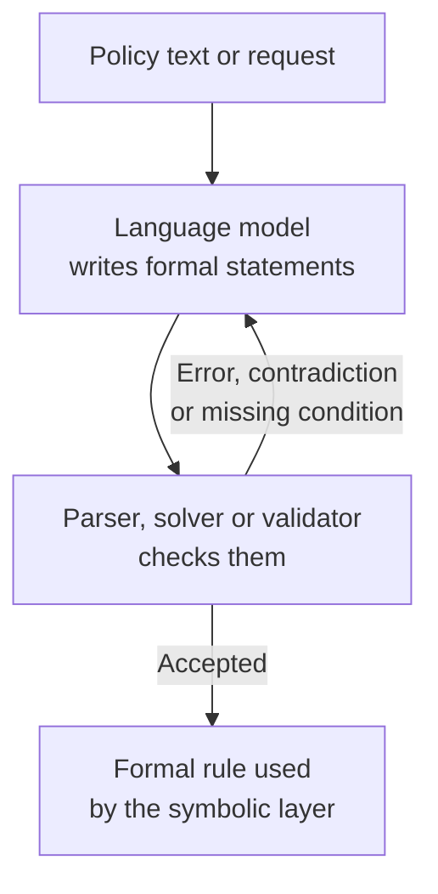

A reasoner cannot read a purchasing policy. It needs the policy as formal statements: symbols, relationships and rules with exact meanings. Someone, or something, has to translate. Translating natural language into a formal representation is called semantic parsing, and it is where most of the neuro-symbolic loop is won or lost.

## One sentence, three targets

Take the policy sentence “No single supplier group may receive more than 60% of an order.” Depending on what the symbolic side does, the translation can take different forms.

For a classical planner, the target is a planning language such as PDDL, which describes states, actions and what each action requires. The LOOP preprint has a language model write those descriptions and a planner solve them. [LOOP preprint](https://arxiv.org/html/2508.13371v1)

For a logic solver, the target might be Answer Set Programming (ASP), a language of facts and rules that a solver searches for consistent answers. Adam Ishay and Joohyung Lee at Arizona State University use language models to write ASP programs for logic puzzles, planning tasks and nonmonotonic reasoning, where conclusions can be withdrawn when exceptions appear. [Ishay and Lee](https://arxiv.org/abs/2604.27960)

For people and machines at once, the target can be a controlled language: a restricted form of English with a precise logical reading. The Wright State group uses Attempto Controlled English, prompting a model to write ACE-compliant statements and checking them with the Attempto parsing engine in a feedback loop, to surface hidden assumptions and preserve the intended meaning. [McCain et al.](https://ceur-ws.org/Vol-4303/pdt-paper103.pdf)

## The first attempt is usually wrong

The striking finding is how ordinary failure is. Ishay and Lee write that a model's initial attempt at writing an ASP program is often flawed. Recent reasoning models fix this by reflecting on the solver's output messages and revising the program, and the authors identify this automated self-correction loop as the primary driver of their results. [Ishay and Lee](https://arxiv.org/abs/2604.27960)

The LOOP preprint found the same pattern in planning: many failures of a one-shot translation traced back to missing action preconditions and incomplete effects. Its answer is also a loop, in which the planner's feedback goes back to the model. [LOOP preprint](https://arxiv.org/html/2508.13371v1)

*Figure 1. Semantic parsing as a loop: the checker's messages go back to the model until the translation is accepted.*

*Alt text: Policy text or a request goes to a language model, which writes formal statements. A parser, solver or validator checks them. Errors, contradictions or missing conditions go back to the model; accepted statements become formal rules used by the symbolic layer.*

## Good errors make good loops

The quality of the loop depends on the quality of the messages coming back. “Syntax error on line 3” lets a model fix a typo. “Group North Holdings would receive 100% of the order; the cap is 60%” lets it fix its reasoning. This is why the prologue insisted on typed hand-offs: a checker can only point at what was stated explicitly.

But a loop that only checks form has a blind spot, and it is the one that matters most in business. A translation can be perfectly well formed, accepted by every parser and solver, and still mean the wrong thing.

:::maths
**For the mathematically curious: a well-formed wrong answer**

Write *share*(*o*, *s*) for supplier *s*'s share of order *o*. The policy intends a cap per group, so first define a group's share as the sum over its member suppliers:

*share*(*o*, *g*) = Σ { *share*(*o*, *s*) : *memberOf*(*s*, *g*) }

and then state the rule:

∀*o* ∀*g* : *share*(*o*, *g*) ≤ 0.6

A model that misreads “supplier group” as “supplier” might produce instead:

∀*o* ∀*s* : *share*(*o*, *s*) ≤ 0.6

Both are valid formulas. Both parse. Both can be checked. The second one approves the 50–50 split between two members of North Holdings, because each supplier record holds only 50%.

The repair loop is easy to write down: φ_{0} = *f*(text), then φ_{*t*+1} = *f*(text, *feedback*(φ_{*t*})), stopping when the checker accepts or *t* reaches a limit. The weakness is in the stopping rule. The checker can accept φ_{*t*} because it is consistent, not because it is faithful. Nothing in the loop compares φ with what the board meant.
:::

That gap is why the symbolic side needs more than a parser. It needs a shared, explicit definition of what the words refer to: what a supplier is, what a group is, how they relate. That is an ontology, and it is the subject of Part 3.

:::question
**A question to sit with.** If a model translated one of your policies into rules tomorrow, who would notice a translation that was well formed but wrong? What would they have to read to notice it?
:::

## Sources

- Ronit Virwani and Ruchika Suryawanshi, [*LOOP: A Plug-and-Play Neuro-Symbolic Framework for Enhancing Planning in Autonomous Systems*](https://arxiv.org/html/2508.13371v1), arXiv preprint, 2025.
- Adam Ishay and Joohyung Lee, [*LLMs as ASP Programmers: Self-Correction Enables Task-Agnostic Nonmonotonic Reasoning*](https://arxiv.org/abs/2604.27960), arXiv preprint, 2026.
- Michael McCain and colleagues, [*Selected Research Directions in NeuroSymbolic AI*](https://ceur-ws.org/Vol-4303/pdt-paper103.pdf), CEUR Workshop Proceedings, Vol. 4303, October 2026.
