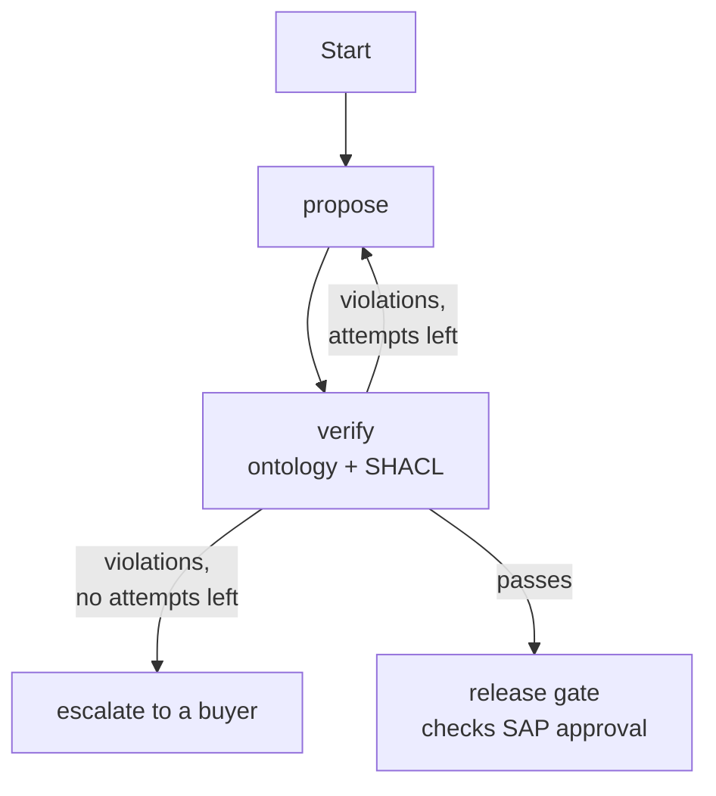

Six parts of argument deserve one of practice. This part builds the procurement loop from the prologue as a small agent in Python. Claude is the agent's brain: it reads supplier quotes and proposes how to split an order. An ontology and SHACL rules check each proposal, and the reasons go back to Claude until the proposal passes, the attempts run out or the order reaches the approval gate.

The full sample is three files and runs offline. [Sample code](https://github.com/Lamiv/Lamiv.github.io/tree/main/blog/code/closing-the-loop)

```text
pip install -r requirements.txt
python nesy_loop.py          # scripted proposer, no API key needed
python nesy_loop.py --live   # Claude as the proposer, needs ANTHROPIC_API_KEY
```

## Who does what

| Role | In this sample | What it decides |
|---|---|---|
| Neural: the agent's brain | Claude, called through the Anthropic Python SDK | How to split the order, given the quotes and any reasons for rejection |
| Symbolic: the rulebook | An ontology in RDF, checked with SHACL rules (rdflib and pySHACL) | Whether a proposal is allowed, and if not, why |
| Workflow | A LangGraph graph | What happens next: retry, escalate or go to the release gate |
| Release gate | A check of the order's SAP approval status | Whether anything is actually released |

Claude never decides compliance and never releases anything. It proposes; the rules and the gate decide.

So that anyone can run the sample without an API key, the default mode swaps Claude for a scripted stand-in that replays three plausible proposals. The `--live` flag puts Claude back in its seat.

## Step 1: write the facts down

The ontology file declares what a supplier, a corporate group, an order and an allocation line are, then records the facts as SAP would hold them. All names and numbers are made up.

```turtle
ex:S100100 a ex:Supplier ; ex:sapId "100100" ; ex:memberOf ex:GroupNorth .
ex:S100200 a ex:Supplier ; ex:sapId "100200" ; ex:memberOf ex:GroupNorth .
ex:S200300 a ex:Supplier ; ex:sapId "200300" ; ex:memberOf ex:GroupEast .
ex:PurchasingPolicy ex:groupCap "0.60"^^xsd:decimal .
ex:PO4500 a ex:PurchaseOrder ; ex:approvalStatus "pending" .
```

## Step 2: write the rule down

As Part 3 noted, OWL cannot add numbers across suppliers, so the cap is a SHACL rule with an embedded SPARQL query. It sums shares *per group*, which is the whole point:

```turtle
SELECT $this ?group ?total ?cap WHERE {
  { SELECT $this ?group (SUM(?s) AS ?total) WHERE {
      $this ex:hasLine ?line .
      ?line ex:share ?s ; ex:supplier/ex:memberOf ?group .
    } GROUP BY $this ?group }
  ex:PurchasingPolicy ex:groupCap ?cap .
  FILTER (?total > ?cap)
}
```

Other shapes require every line to name one known supplier, a share between 0 and 1 and a quote reference, require every supplier to have a parent group, and require the shares to add up to the whole order.

## Step 3: a typed hand-off from Claude

Claude must return data, not prose. A Pydantic model defines the contract (shown here without its field descriptions).

```python
class Line(BaseModel):
    supplier_id: str   # SAP supplier ID
    share: float       # fraction of the order
    quote_ref: str     # where the figures came from

class Proposal(BaseModel):
    lines: list[Line]
    rationale: str
```

The live proposer sends Claude the quotes, plus the reasons for any earlier rejection, and asks for an answer in exactly that shape. The SDK's structured-output support enforces the schema and returns a validated `Proposal` object, so the rules always receive supplier IDs, numbers and quote references, never a paragraph.

```python
prompt = f"Split purchase order PO4500 between suppliers to get the best price.\n\nQuotes:\n{QUOTES}\n"
if violations:
    prompt += "\nYour last proposal was rejected by the policy check:\n- " + "\n- ".join(violations) + "\nRevise it."
response = client.beta.messages.parse(
    model="claude-opus-5-5",
    messages=[{"role": "user", "content": prompt}],
    output_format=Proposal,   # Claude's answer must fit the typed contract
    ...                       # token limit, effort and fallback settings
)
proposal = response.parsed_output
```

Notice what Claude is *not* told: which suppliers belong to which group. It sees three quotes from three supplier records. The names hint that two are related, but hints are not facts. Group membership lives in the ontology, and the prompt mentions a group only when a rejection names one.

## Step 4: ground, then check

Grounding turns each SAP ID into an entity in the ontology; an unknown ID becomes a reason rather than a crash. Checking runs pySHACL over the facts plus the proposal and returns the violation messages as plain sentences the model can act on.

```python
def check(proposal: Proposal) -> list[str]:
    statements, problems = ground(proposal)
    conforms, report, _ = validate(KNOWLEDGE + statements, shacl_graph=SHAPES,
                                   inference="rdfs", advanced=True)
    ...  # collect sh:resultMessage from the report
    return sorted(set(problems))
```

## Step 5: the loop as a graph

LangGraph makes the loop explicit. After every check, a router decides where to go next.

```python
def route(state: State) -> str:
    if not state["violations"]:
        return "release_gate"
    return "escalate" if state["attempts"] >= MAX_ATTEMPTS else "propose"
```



*Figure 1. The workflow: proposals loop through verification until they pass, run out of attempts or reach the release gate.*

*Alt text: Start leads to propose, then verify with the ontology and SHACL. Violations with attempts left go back to propose; violations with no attempts left go to escalate to a buyer; a passing proposal goes to the release gate, which checks SAP approval.*


## Running it

Here is the complete output of `python nesy_loop.py`, the offline mode with the scripted proposer:

```text
[attempt 1] proposes 100100: 80%, 200300: 20%
  why: Take the 15% discount on most of the volume.
  check: fails
    - Group North Holdings would receive 0.8 of the order; the cap is 0.60.

[attempt 2] proposes 100100: 50%, 100200: 50%
  why: Split evenly between the two cheapest suppliers.
  check: fails
    - Group North Holdings would receive 1.0 of the order; the cap is 0.60.

[attempt 3] proposes 100100: 60%, 200300: 40%
  why: Keep North at the cap and still earn the 15% tier.
  check: passes

Compliant draft routed for approval (status: pending); nothing released.
```

Each block is one trip around the loop:

- **`proposes`** is the split the proposer suggested, as SAP supplier IDs and shares of the order.
- **`why`** is the proposer's own rationale, carried in the `Proposal`.
- **`check`** is the verdict from the ontology and SHACL rules.
- **The indented lines** are the reasons, sent back word for word as input to the next attempt.
- **The last line** is the release gate's decision.

In plain words, here is what happened:

1. It chased the 15% discount with 80% to supplier 100100. Rejected: North Holdings would get 80% against a 60% cap.
2. It split the order 50–50 between 100100 and 100200. Rejected again: both records belong to North Holdings, which would get the whole order. This is the prologue's trap, which a per-record check would have passed.
3. It kept North at exactly 60%, still inside the 15% tier, and gave 40% to East. Passed.

The release gate then checked SAP. Approval was still pending, so the compliant draft was routed for approval and nothing was released.

In live mode, Claude writes the proposals and rationales, so the attempts will differ from run to run. A proposal may pass at the first attempt, or the loop may run out of attempts and escalate to a buyer. The loop, the reasons and the gate stay the same.

## What production would add

This is teaching code. A real deployment would read suppliers and groups from SAP master data rather than a file, pause for a human approver (LangGraph supports interrupting a graph and resuming it), record every proposal, reason and decision for audit, keep provenance on every fact as Part 4 described, and be evaluated the way the prologue suggested: by inspecting the first proposal, the check's response and the next proposal, not only the final outcome.

:::maths
**For the mathematically curious: why the loop needs a bound**

If each attempt succeeded independently with probability *p*, the chance of success within *k* attempts would be 1 − (1 − *p*)ᵏ, and more attempts would always help. Feedback breaks the independence, for better or worse. Good reasons raise *p* on each retry. A model that keeps making the same mistake has *p* close to zero on every retry, and more attempts only add cost.

That is why the graph has `MAX_ATTEMPTS` and an escalation path. The bound guarantees the loop ends; the escalation, carrying the reasons collected so far, guarantees it ends somewhere useful.
:::

:::question
**A question to sit with.** What would your `MAX_ATTEMPTS` be, and who would receive the escalation? If the honest answer is “nobody”, the loop is not closed yet.
:::

That closes the series. The loop is not a model and not a rulebook, but the conversation between them: what travels each way, who defines the words, and who approves the changes.

## Sources

- [Sample code for this part](https://github.com/Lamiv/Lamiv.github.io/tree/main/blog/code/closing-the-loop): `procurement.ttl`, `shapes.ttl`, `nesy_loop.py`.
- [LangGraph](https://github.com/langchain-ai/langgraph), [rdflib](https://github.com/RDFLib/rdflib) and [pySHACL](https://github.com/RDFLib/pySHACL), the open-source libraries the sample uses.
