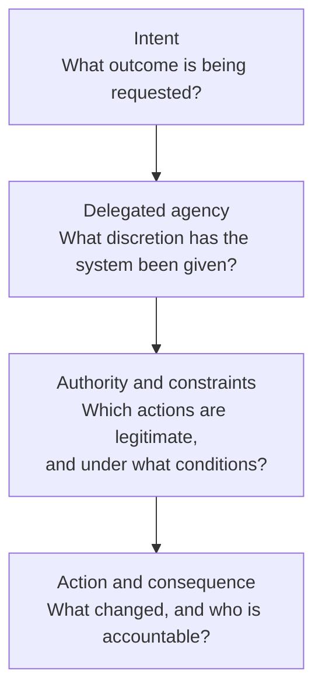

A buyer types six words into an assistant: “Take care of this order, please.” It sounds like one instruction. It is really five or six separate grants of authority, and most of the trouble with AI agents in the enterprise comes from treating them as one.

## One request, six steps

Follow the order through. The agent reads three supplier quotes and the contract history. It compares prices and terms. It drafts a purchase order in the company's purchasing system. Someone approves it. The order is released. The system sends it to the supplier, who starts planning production around it.

Each step asks for something different. Reading quotes needs access to information. Drafting needs permission to create a record that anyone can still change. Approving needs a person with the right to commit the company's money. Sending needs nothing more than a released order, and once it has happened, a supplier outside the company is acting on it.

“Take care of this” does not say which of these the buyer meant to hand over. The system has to.

The same shape appears wherever agents act. A finance agent can prepare a payment run, but releasing it moves money. A customer-service agent can draft a reply and a goodwill credit, but issuing the credit is a commitment. An operations agent can plan an infrastructure change, but applying it to production changes what customers experience. An agent on an industrial line can recommend a new setpoint, but writing it to a controller changes a physical process.

## A model of delegated agency

It helps to separate four questions that every one of these examples raises.

*Figure 1. A conceptual model of delegated agency, not a software architecture.*

*Alt text: Four stacked layers. Intent: what outcome is being requested. Delegated agency: what discretion the system has been given. Authority and constraints: which actions are legitimate, and under what conditions. Action and consequence: what changed, and who is accountable.*

The diagram deliberately says nothing about where a policy engine, an approval service or an identity provider sits. Those are implementation choices, and different platforms make them differently. This series is about what must be true whichever choices are made.

## Four words that are often blurred

**Agency** is what the agent can perceive and affect: the data it can read and the tools it can use. Damir Safin and Dian Balta of fortiss grade it in five levels, from reasoning over text it is given (L1), through read-only access to outside systems (L3), to writes that are cheap to undo, such as drafts (L4), and writes that are costly to undo, such as final submissions and payments (L5). [Safin and Balta](https://arxiv.org/abs/2605.12105)

**Autonomy** is how much happens without a person. Their five levels run from an *operator*, where a human commands each sub-task, to an *approver*, where the agent executes but pauses for explicit sign-off before consequential actions, to an *observer*, where it runs on its own and people monitor and can intervene. [Safin and Balta](https://arxiv.org/abs/2605.12105)

**Authorisation** is what the agent is permitted to do, and on whose behalf. In most enterprise systems that comes down to roles and the identity an action executes under, which Part 3 takes apart. UC Berkeley's agentic AI risk profile puts the principle simply: apply least privilege when granting agents access. [CLTC](https://cltc.berkeley.edu/agentic-ai-risk-management-standards-profile)

**Accountability** is who answers for the outcome. The same profile lists clear role definitions, intervention points, escalation pathways and shutdown mechanisms as levers of human control and accountability. [CLTC](https://cltc.berkeley.edu/agentic-ai-risk-management-standards-profile)

Safin and Balta make one distinction sharper than any other: *whether a human must approve an action is determined by the autonomy design; whether the action can be undone is a property of the action itself.* [Safin and Balta](https://arxiv.org/abs/2605.12105) You choose the first. You inherit the second.

## Think freely, act narrowly

The useful consequence is that the four can be set independently. An agent can have wide freedom to read, compare and propose while its authority to commit is narrow. Safin and Balta describe an *autonomous monitor*: high autonomy, but read-only agency, so it cannot alter any system of record and the risk of a consequential wrong action is minimised. They also describe the opposite, a *supertool*: powerful, often irreversible capabilities, deliberately kept at low autonomy so a person orchestrates every use. [Safin and Balta](https://arxiv.org/abs/2605.12105)

For the buyer's order, that suggests a shape. Let the agent roam through quotes, history and contract terms. Let it draft. Keep approval, release and sending where accountability already lives.

## Three ways it goes wrong

The AI Safety Atlas sorts AI risks by cause: *misuse*, where people use a system to cause harm; *misalignment*, where a system pursues goals other than the ones intended; and *systemic* risks that emerge from many interactions, with overlap between all three. [AI Safety Atlas](https://ai-safety-atlas.com/chapters/v1/risks/risk-decomposition)

In procurement they look ordinary. Misuse is a supplier's email that steers the agent. Misalignment is an agent that optimises the price and ignores the cap on supplier concentration. Systemic risk is an organisation that slowly stops checking what its agents propose.

## What this series argues

Each part defends a property that should hold whatever framework, platform or vendor an agent is built on:

1. The ability to invoke a tool does not, by itself, establish legitimate authority to perform the action.
2. Approval should be bound to the action and the conditions that were actually authorised.
3. Recovery must account for effects outside the system, not only restore the agent's own state.
4. An instruction telling a model to obey a policy is not the same as a trusted mechanism enforcing that policy.
5. More autonomy should be granted on evidence that the system operates within its authorised boundaries.

Where a part discusses a control, it separates the *property* that must hold from the *mechanisms* that could provide it. A property can be met by the application itself, by the agent's runtime, by an identity service or by a separate policy layer; which one is a design decision for each organisation.

## The series

1. **Choose the action before the agent**: which steps can be automatic, which bounded, which human.
2. **Can you undo what it just did?** Restoring, compensating and living with it.
3. **Whose authority is it acting on?** Requester, agent, executing identity and approver.
4. **What exactly did the human approve?** Binding approval to the terms that were seen.
5. **When the agent's inputs turn against it**: injected instructions and poisoned memory.
6. **How does an agent earn more autonomy?** Evidence for widening authority, and triggers for narrowing it.
7. **Build the boundary**: one order traced through every property.
8. **When the role is wrong**: defence in depth, and what a risk framework is for.

:::risk
**Averting risk**

| Risk | Required property | Possible mechanisms | Still not covered |
|---|---|---|---|
| One vague request is read as a grant of every step | Authority is granted per action, not per request | Per-step permissions; action catalogues; approval rules | Steps nobody listed |
| The agent can do more than the task needs | Least privilege: reach matched to the task | Scoped credentials; narrowed tools; separate read and write paths | Broad rights held by the person it acts for |
| Nobody owns the outcome | Every consequential action has an accountable owner | Named roles, intervention points, escalation and shutdown procedures | Owners who never look |
:::

:::question
**A question to sit with.** Pick one process your teams want an agent for. Can you list its steps and say, for each, whether the agent may read, draft, decide or commit?
:::

## Sources

- Damir Safin and Dian Balta, [*Autonomy and Agency in Agentic AI: Architectural Tactics for Regulated Contexts*](https://arxiv.org/abs/2605.12105), arXiv preprint, May 2026.
- Nada Madkour and colleagues, UC Berkeley Center for Long-Term Cybersecurity, [*Agentic AI Risk-Management Standards Profile*](https://cltc.berkeley.edu/agentic-ai-risk-management-standards-profile), version 1.0, February 2026.
- Markov Grey and Charbel-Raphaël Segerie, [*AI Safety Atlas*, Risks chapter](https://ai-safety-atlas.com/chapters/v1/risks/risk-decomposition).
