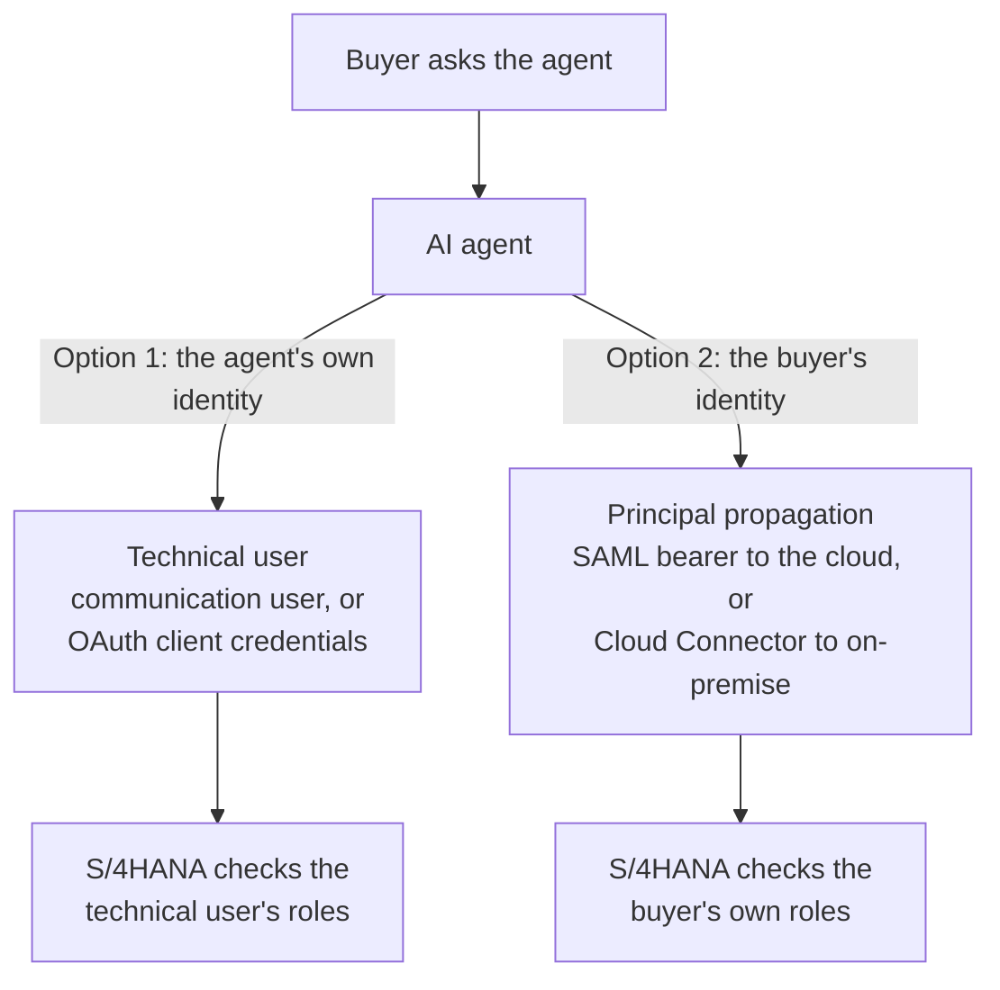

When an agent creates a purchase order in SAP S/4HANA, four parties are involved, and it pays to keep them apart. The **requester** is the buyer who asked. The **agent** is the software that did the work. The **executing identity** is the user SAP believes performed the action, and whose roles it checked. The **approver** is the person workflow asks to approve or release it. Most agent designs blur at least two of them.

## How S/4HANA decides what a user may do

S/4HANA is role-based. In on-premise and private cloud systems, roles maintained in transaction PFCG carry the authorisations that let a user start an app and read or change data. Business catalogs group apps *according to segregation of duty*, and business roles collect catalogs for a job. [SAP Learning](https://learning.sap.com/courses/exploring-the-authorization-concept-for-sap-fiori-on-sap-s-4hana/explaining-sap-fiori-authorization-model) Users cannot give themselves access; they can only rearrange what their roles already grant. [SAP Learning](https://learning.sap.com/courses/implementing-sap-s-4hana-cloud-private-edition/assigning-permissions-to-users_fe48dd0d-6d13-4995-bfea-edccba5dbd7a)

That makes the executing identity the decisive choice. Whatever identity the agent's calls arrive under, its roles become the agent's effective authority.

## Two ways to call SAP

The agent always authenticates as itself to whatever sits in front of SAP. The real design question is a different one: *whose identity does SAP execute the call under, and so whose roles does it check?* There are two answers.

*Figure 1. Two ways an agent can call SAP: as itself, or as the person who asked. The transport differs by edition; the choice of identity is what matters.*

*Alt text: A buyer asks an AI agent. Option 1: the agent calls SAP as a technical user, a communication user or OAuth client credentials, and S/4HANA checks the technical user's roles. Option 2: the agent calls SAP with the buyer's identity through principal propagation, SAML bearer to the cloud or the Cloud Connector to on-premise, and S/4HANA checks the buyer's own roles.*

**Option 1: the agent's own identity.** In S/4HANA Cloud, public edition, external systems usually call APIs through a *communication user* defined in a *communication arrangement*, which fixes which system may call which APIs. A business partner created this way is created by the technical communication user; no business user is involved at all. [SAP Developers](https://developers.sap.com/tutorials/abap-environment-business-partner-basic-auth.html) The same identity can also travel through BTP's connectivity services, for example to an on-premise system, which SAP calls *technical user propagation*: a technical user obtained with OAuth client credentials, sent instead of a business user. [SAP BTP documentation](https://github.com/SAP-docs/btp-connectivity/blob/main/docs/1-connectivity-documentation/technical-user-propagation-8b6e019.md) Every agent action then appears under one technical identity, with its rights, whoever asked. That suits background jobs that act for nobody in particular.

**Option 2: the requester's identity.** SAP calls this *principal propagation*: forwarding the identity of the logged-on user to the backend so that the backend applies that user's roles. [SAP BTP documentation](https://github.com/SAP-docs/btp-connectivity/blob/main/docs/1-connectivity-documentation/principal-propagation-e2cbb48.md) The transport differs by edition:

- *To S/4HANA Cloud*, a BTP destination of type `OAuth2SAMLBearerAssertion` has the Destination service wrap the user's identity in a SAML assertion, sign it with the subaccount's key and exchange it for an OAuth access token. [SAP BTP documentation](https://github.com/SAP-docs/btp-connectivity/blob/main/docs/1-connectivity-documentation/cloud-to-cloud-65b11d4.md) S/4HANA must trust the signing system, and the communication arrangement must allow OAuth 2.0 for inbound calls. [SAP Developers](https://developers.sap.com/tutorials/abap-environment-business-partner-oauthsamlbearer.html)
- *To on-premise or private cloud systems*, a destination of type `PrincipalPropagation` goes through the Cloud Connector. It verifies the user's token and issues a short-lived X.509 certificate for that user; the ABAP system maps the certificate to a user with rule-based mapping in transaction CERTRULE. [SAP BTP documentation](https://github.com/SAP-docs/btp-connectivity/blob/main/docs/1-connectivity-documentation/cloud-to-on-premise-70b8ef3.md) [SAP BTP documentation](https://github.com/SAP-docs/btp-connectivity/blob/main/docs/1-connectivity-documentation/rule-based-mapping-of-certificates-4f8540f.md)

For work done at a person's request, option 2 is usually right: SAP applies the requester's own permissions and records the requester as the one who acted.

## Where the agent's identity lives

Propagation solves one problem and exposes another. SAP now checks the buyer's roles, but the identity that reaches S/4HANA is the buyer's, not the agent's. The fact that an agent acted is known only to the layers in front of SAP.

Those layers can record it precisely. An enterprise gateway design from August 2026 uses OAuth 2.0 token exchange (RFC 8693) to issue a single signed token carrying both identities: `sub` is the user and `act.sub` is the agent, with each further hop adding a level, *a complete, cryptographically bound delegation trail*. The authors flag the most common misconfiguration: the exchange must check that the incoming token was issued to the agent, not to the gateway. [Kumar, Wang and Manoharan](https://arxiv.org/abs/2608.10760) Kalyanasundaram argues that each agent needs a unique, verifiable identity bound to an accountable owner, governed through four fundamentals: administer, authenticate, authorise and audit. [Kalyanasundaram](https://ceur-ws.org/Vol-4257/position1.pdf)

## Borrowed authority is too much authority

Propagation has a second catch. The agent inherits all of the buyer's rights, not only the ones the task needs. If the buyer can also release orders, so can anything acting as the buyer.

Researchers at EPFL show one way to narrow it. CAPMAS maps a request to a bounded set of privileges and issues tokens that each agent can narrow further, offline, but never widen. Compared with OAuth token exchange, they report 30 times faster delegation operations and up to 3 times lower bandwidth, while cutting unnecessary privileges by 99.5% against propagating all of the user's privileges. [Veski, Guerraoui and Froelicher](https://arxiv.org/abs/2609.06500) The principle carries over even without their tooling: the agent's tools should expose only the operations the task needs, whatever the user could do.

## Segregation of duties survives, if you keep it

S/4HANA's flexible workflow can exclude a purchase order's creator from approving it. [SAP Learning](https://learning.sap.com/courses/implementing-sap-s-4hana-cloud-public-edition-sourcing-and-procurement/defining-workflows-in-sourcing-and-procurement_a17030df-33b7-4c0e-a8c6-31ec490618e9) With propagation, the creator is the buyer who asked, so the buyer cannot approve the agent's work on their own request. With a shared technical user, the creator is the technical user, and that protection quietly disappears.

## What your team has to build

SAP provides the identity plumbing and the role checks. The application team still has to build these:

- Record the agent's identity alongside the user's, outside SAP, and link it to the SAP document number.
- Limit the agent's tools to the task, below the user's full rights.
- Decide when propagation is required and when a technical user is acceptable, per action.
- Keep the mapping between corporate identities and SAP users accurate, because propagation is only as good as that mapping.

:::risk
**Averting risk**

| Risk | Strategy | What it still does not cover |
|---|---|---|
| Every agent action appears under one shared identity | Principal propagation for actions taken at a person's request | Background jobs that genuinely act for nobody |
| The agent inherits all of the user's rights | Narrow tools and scopes below the user's rights | Mistakes within the narrowed scope |
| SAP cannot tell agent work from human work | Delegation trail (`sub` plus `act`) recorded at the gateway and linked to SAP documents | Gaps where the gateway is bypassed |
| The requester approves their own agent's order | Exclude the creator in flexible workflow; use propagation so the creator is the requester | Approvers who share a desk |
:::

:::question
**A question to sit with.** If an auditor picked one purchase order your agent created, could you show who asked, which agent acted, which SAP identity executed it, and who approved it?
:::

## Sources

- SAP Learning, [*Explaining SAP Fiori Authorization Model*](https://learning.sap.com/courses/exploring-the-authorization-concept-for-sap-fiori-on-sap-s-4hana/explaining-sap-fiori-authorization-model) and [*Assigning Permissions to Users*](https://learning.sap.com/courses/implementing-sap-s-4hana-cloud-private-edition/assigning-permissions-to-users_fe48dd0d-6d13-4995-bfea-edccba5dbd7a).
- SAP Developers, [*Integrate SAP BTP, ABAP environment and SAP S/4HANA Cloud, public edition using Basic Authentication*](https://developers.sap.com/tutorials/abap-environment-business-partner-basic-auth.html) and [*… using the OAuth 2.0 SAML Bearer Assertion Flow*](https://developers.sap.com/tutorials/abap-environment-business-partner-oauthsamlbearer.html).
- SAP, [*SAP BTP Connectivity documentation*](https://github.com/SAP-docs/btp-connectivity), published source of the SAP Help Portal pages on principal propagation and technical user propagation.
- SAP Learning, [*Defining Workflows in Sourcing and Procurement*](https://learning.sap.com/courses/implementing-sap-s-4hana-cloud-public-edition-sourcing-and-procurement/defining-workflows-in-sourcing-and-procurement_a17030df-33b7-4c0e-a8c6-31ec490618e9).
- Suraj Kumar, Amy Wang and Srinivasan Manoharan, [*A Gateway Architecture for Enterprise MCP Authentication*](https://arxiv.org/abs/2608.10760), arXiv preprint, August 2026.
- Thivaharan Kalyanasundaram, [*Identity and Access Management for AI Agents*](https://ceur-ws.org/Vol-4257/position1.pdf), CEUR Workshop Proceedings, Vol. 4257.
- Rasmus Moorits Veski, Rachid Guerraoui and David Froelicher, [*CAPMAS: Capability-Based Delegation of Privileges in Multi-Agent Systems*](https://arxiv.org/abs/2609.06500), arXiv preprint, September 2026.
