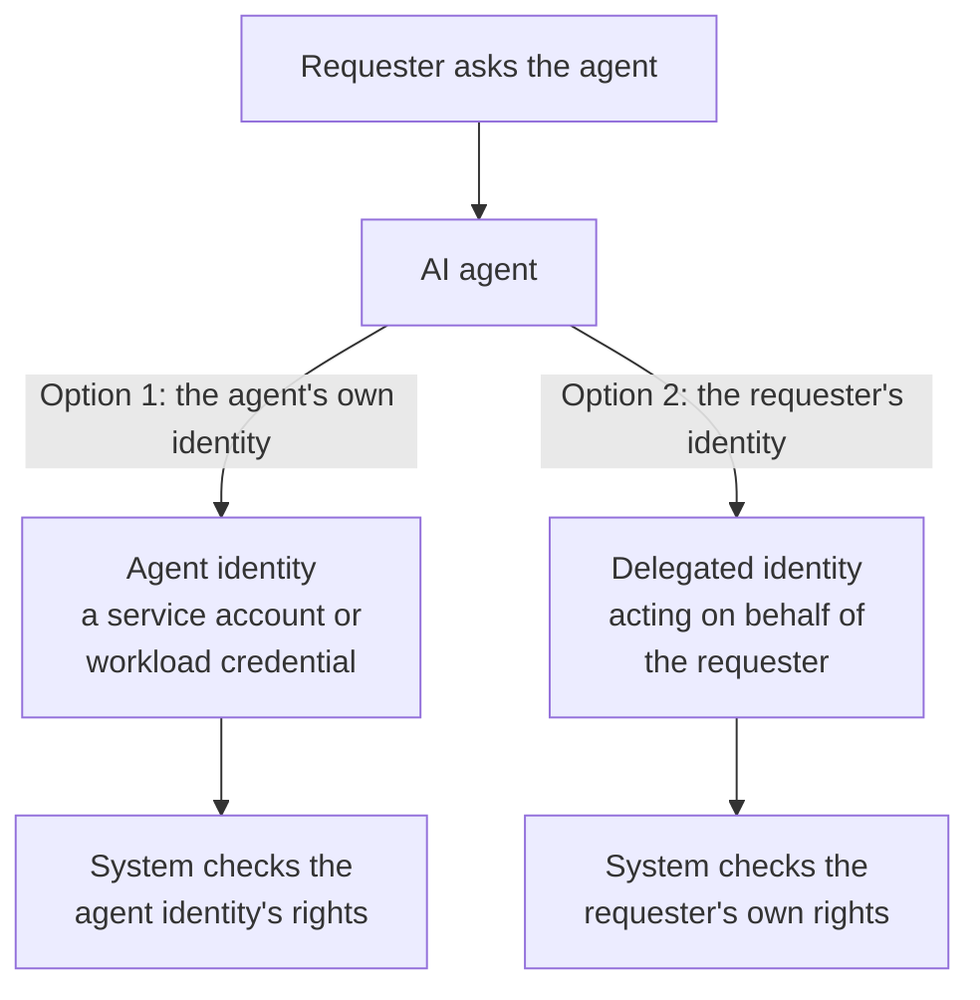

When an agent creates a purchase order, four parties are involved, and it pays to keep them apart. The **requester** is the buyer who asked. The **agent** is the software that did the work. The **executing identity** is the identity the system of record believes performed the action, and whose rights it checked. The **approver** is the person who approves or releases it. Most agent designs blur at least two of them.

The property this part defends is simple to state: *when an agent performs a consequential action, the system must be able to establish the authority under which that action was permitted.* Whether the application, the agent's runtime, an identity service or a separate policy layer provides that is an implementation decision. Different platforms answer it differently, and more than one answer can be right.

## How enterprise systems decide what a user may do

Most enterprise systems are role-based. A user's roles determine which functions they can start and which data they can read or change, and segregation of duties is designed into how those roles are cut, so that one person cannot, for example, both create a supplier and pay it. Users cannot give themselves access; they can only use what their roles grant.

That makes the executing identity the decisive choice. Whatever identity the agent's actions arrive under, its rights become the agent's effective authority as far as the system of record is concerned.

## Two ways an agent can act

The agent always authenticates as itself to whatever it talks to first. The real design question is a different one: *whose identity does the system of record execute the action under, and so whose rights does it check?* There are two answers.

*Figure 1. An agent can act under its own identity or under the requester's. Each choice makes the system of record see only one side of the delegation.*

*Alt text: A requester asks an AI agent. Option 1: the agent acts under its own identity, a service account or workload credential, and the system checks that identity's rights. Option 2: the agent acts under a delegated identity on behalf of the requester, and the system checks the requester's own rights.*

**Option 1: the agent's own identity.** The agent uses a service account or workload credential of its own. This is simple and suits background work that acts for nobody in particular. But every action then appears under one identity, with that identity's rights, whoever asked. The requester's own limits are invisible unless something else checks them.

**Option 2: the requester's identity.** The agent acts on behalf of the person who asked, through some form of delegated or propagated identity, so the system of record applies that person's rights and records them as the one who acted. For work done at a person's request, this keeps the person's limits in force. But now the system of record may not know that an agent was involved at all.

## Authority is an intersection

Neither option, on its own, captures what the authority actually is. The action should be permitted only if it falls inside all three of these at once:

- what the **requester** is allowed to do;
- what the **agent** has been delegated to do;
- what the **task** in hand requires.

Option 1 sees only the agent's side of that intersection. Option 2 sees only the requester's. The property is that *something* can see both, at the moment the action is taken, and record which ones were checked.

There are several ways to provide it. An enterprise gateway design from August 2026 uses OAuth 2.0 token exchange to issue a single signed token carrying both identities: `sub` is the user and `act.sub` is the agent, with each further hop adding a level, *a complete, cryptographically bound delegation trail*. The authors flag the most common misconfiguration: the exchange must check that the incoming token was issued to the agent, not to the gateway. [Kumar, Wang and Manoharan](https://arxiv.org/abs/2608.10760) Kalyanasundaram argues that each agent needs a unique, verifiable identity bound to an accountable owner, governed through four fundamentals: administer, authenticate, authorise and audit, built by extending established standards rather than inventing new ones. [Kalyanasundaram](https://ceur-ws.org/Vol-4257/position1.pdf) An application can equally check both identities itself, if it is told about both.

## Borrowed authority is too much authority

Delegation has a further catch. Acting as the requester, the agent inherits all of the requester's rights, not only those the task needs. If the buyer can also release orders, so can anything acting as the buyer, unless the task scope narrows it.

Researchers at EPFL show one way to narrow it. CAPMAS maps a request to a bounded set of privileges and issues tokens that each agent can narrow further, offline, but never widen. Compared with OAuth token exchange, they report 30 times faster delegation operations and up to 3 times lower bandwidth, while cutting unnecessary privileges by 99.5% against propagating all of the user's privileges. [Veski, Guerraoui and Froelicher](https://arxiv.org/abs/2609.06500) The principle holds without their tooling: the agent's reach should match the task, whatever the requester could do.

## Segregation of duties survives, if you keep it

Many approval processes can stop a document's creator from approving it. Which identity counts as the creator then matters. If the agent acts under the requester's identity, the requester created the order and cannot approve the agent's work on their own request. If it acts under a shared agent identity, the "creator" is the agent's account, and that protection can quietly disappear unless the approval rules know who actually asked.

## What has to be true

Whatever the platform, these should hold:

- For every consequential action, the requester, the agent and the executing identity can all be established afterwards, and linked to the business document.
- The agent's reach is narrower than the requester's full rights whenever the task is narrower.
- The choice between the agent's identity and the requester's is made per action, deliberately.
- The mapping between people's identities and their accounts in each system is accurate, because delegation is only as good as that mapping.

:::risk
**Averting risk**

| Risk | Required property | Possible mechanisms | Still not covered |
|---|---|---|---|
| Every agent action appears under one shared identity | Actions taken at a person's request carry that person's authority | Delegated or propagated identity; on-behalf-of flows; checks in the application | Work that genuinely acts for nobody |
| The agent inherits all of the requester's rights | Effective authority is the intersection of requester, agent and task | Narrowed tools; scoped or attenuated tokens; policy checks on each action | Mistakes within the narrowed scope |
| Nobody can tell agent work from human work | Both identities can be established for every action | Tokens carrying both identities; linked logs; application-level records | Paths that bypass the recording point |
| The requester approves their own agent's work | The person who asked cannot approve the result | Creator exclusion in approval rules, with the creator set to the requester | Approvers who share a desk |
:::

:::question
**A question to sit with.** If an auditor picked one purchase order your agent created, could you show who asked, which agent acted, which identity executed it, and who approved it?
:::

## Sources

- Suraj Kumar, Amy Wang and Srinivasan Manoharan, [*A Gateway Architecture for Enterprise MCP Authentication*](https://arxiv.org/abs/2608.10760), arXiv preprint, August 2026.
- Thivaharan Kalyanasundaram, [*Identity and Access Management for AI Agents*](https://ceur-ws.org/Vol-4257/position1.pdf), CEUR Workshop Proceedings, Vol. 4257.
- Rasmus Moorits Veski, Rachid Guerraoui and David Froelicher, [*CAPMAS: Capability-Based Delegation of Privileges in Multi-Agent Systems*](https://arxiv.org/abs/2609.06500), arXiv preprint, September 2026.
