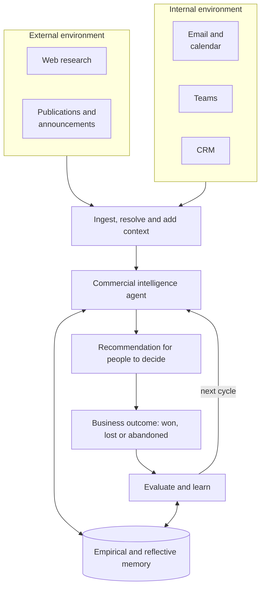

[Part 1](intelligence-that-compounds-1-building-it.html) built the agent, mostly by conversation. This part looks at what it produced, what that means in practice, and what the same pattern would mean for an organisation that wants to learn from its own decisions rather than only record them.

There are no performance results yet, and there should not be: an agent's record begins with its first forecast made before the outcome existed, and that was on 24 November. What there is already is more useful at this stage: a first live output that can be read against the design, and a clear view of how results will be judged when they arrive.

## How we will know

The Brier score is the primary measure because it rewards honest confidence: a forecast of 80% that turns out wrong scores 0.64, while always saying 50% scores 0.25. [Wikipedia](https://en.wikipedia.org/wiki/Brier_score) An agent that is often confidently wrong does worse than one that admits uncertainty.

Three comparisons matter, all on the same future dates: the learning agent against the no-change forecast, which any skill must beat; against the fixed V1 forecast, which shows whether learning added anything; and each challenger against the strategy it would replace. Because every test runs forward on dates that did not exist when it began, this is walk-forward evaluation, the standard defence against strategies that merely fit the past. [Wikipedia](https://en.wikipedia.org/wiki/Walk_forward_optimization)

Eight to twelve weeks gives a first dataset, not a verdict. The year of loaded history gives context, not experience: the agent's record begins with its first forecast made before the outcome existed. I will publish results here when there are enough to say something, including if the learning agent does worse than the baselines.

## The first live forecast

On 24 November the agent made its first live forecast. This is what it published.

![Screenshot of the Brent intelligence terminal for 24 November 2026: reference settlement $89.37 for the January 2027 futures contract on 23 November; forecast settlement $88.92 for 25 November, minus 0.50%; probability of upside 43%, labelled judgmental and uncalibrated; a chart of the FRED spot series from 11 to 17 November, labelled as a separate series that is stale for scoring; and an evidence balance listing recovering supply, a Libya pipeline restart and an unconfirmed inventory build as bearish drivers, against Hormuz logistics risk, physical supply vulnerability and reported backwardation as bullish counterweights.](img/compounds/terminal.webp)

*Figure 1. The agent's first forecast, as it appears in Notion. A real output from the experiment, not an illustration.*

Several details are worth reading closely, because they show the design doing its job.

**It chose a precise target, and kept the stale one at arm's length.** The forecast is scored against the settlement of a named contract, ICE Brent January 2027 futures: $89.37 on 23 November, forecast at $88.92 for 25 November, a fall of 0.50%. Naming the contract matters, because ICE's January contract stops trading on the last business day of November and a later contract then becomes the front month. [ICE](https://www.ice.com/products/219/Brent-Crude-Futures) The FRED spot series still appears, but as a separate chart labelled *stale for scored spot forecast*: the agent itself recognised the publication delay that [Part 1](intelligence-that-compounds-1-building-it.html) identified as the design's most important flaw.

**It is honest about its confidence.** The probability of a rise is 43%, labelled *judgmental, uncalibrated*. That is the right label for a first forecast: there is no record yet against which to calibrate it. The Brier score will make the stakes concrete. If Brent falls, the forecast scores 0.43², about 0.18; if it rises, 0.57², about 0.32. A plain 50% scores 0.25 either way, so this forecast beats a coin only if its lean turns out to be right.

**It separates fact from expectation.** The evidence balance lists bearish drivers against bullish counterweights, and marks the expected inventory build as *unconfirmed*. The footer says what the forecast is not: research only, no trade execution, and pending independent verification of the settlement, because the reference price came from news reporting rather than an official feed.

**It still shows how subtle the timing is.** The forecast was frozen at 14:30 UTC on 24 November, but it is measured from the 23 November settlement, so most of a trading day had already happened before the freeze. Some of the move it forecasts may already have been visible. The cleaner version measures from the first settlement *after* the freeze, the one on 24 November. This is exactly the kind of thing the weekly review exists to catch, and a good argument for having one.

*Figure 2. Scenarios around the forecast. The agent labels them as illustrative sensitivities; only the central forecast is recorded and scored.*

Alongside the forecast, the Scenario and Risk Monitor page shows what plus or minus 3% would mean, and keeps a risk register with a control for each risk: match the January 2027 settlement exactly, against contract mismatch; search for contradictory evidence, against narrative bias; preserve retrieval and observation dates, against publication delay; score probabilities with the Brier score, against overconfidence; and freeze forecasts before the target date, against lookahead. The scenarios are clearly marked as sensitivities, not extra forecasts, which keeps the record honest: one forecast, one score.

*Figure 3. The first hypothesis, on day one: proposed, untested and not activated.*

The Learning Laboratory already holds a first hypothesis: *physical supply recovery may outweigh geopolitical headlines when export flows improve.* Its status is the most important part. Proposed, untested; the candidate strategy not activated; to be tested on identical future dates, at least thirty of them, against criteria registered in advance. On day one, the learning loop is a commitment, not a result. That is how it should be.

### What Notion adds

Because the agent's interpretation lives in Notion, the experiment gains things a database alone would not give it.

*Figure 4. The forecast as a Notion page: a short thesis, the time it was frozen, its sources, and an attached dashboard.*

**It can be shared.** A Notion page can be shared with chosen colleagues or guests at a chosen permission level, or published to the web. [Notion](https://www.notion.com/help/sharing-and-permissions) The research becomes something a team reads, not a file one person keeps.

**It can be discussed where it is written.** Readers can comment on a whole page or on a specific sentence. [Notion](https://www.notion.com/help/comments-mentions-and-reminders) A colleague who doubts the Libya assumption can say so next to it, and the weekly review becomes a conversation in place rather than a meeting about a document.

**It can be questioned.** Notion AI answers questions from the pages in a workspace that the person asking has access to, and follows the workspace's access rules. [Notion](https://www.notion.com/help/notion-ai-faqs) Anyone on the team can ask which hypotheses are waiting for a decision, or what the agent said about inventories last week, without reading every page.

Each of these has a governance edge. Sharing is an access decision: share the dashboards widely, but keep the Decisions page editable by its owner alone. Notion AI answers from Notion, which holds the interpretation; the numbers that count are in Supabase, and a dashboard figure should be checked against them before it is quoted. And Notion's own agent can create and edit pages, which makes it one more writer in the workspace to account for.

## What it means in practice

One forecast proves nothing about Brent. It says a good deal about building systems like this.

**The cost of building has collapsed; the cost of judging has not.** The agent, its database, its workspace and its schedule were built by conversation, and each cycle, from research to forecast to updated Notion pages, completes in about ten minutes. The first evidence worth reading will take eight to twelve weeks, and the most valuable hours in the whole project were spent reviewing a design, not producing one. In an organisation, that changes where AI effort should be budgeted: less on building, more on review, measurement and ownership.

**A capable designer still needs a reviewer.** The live system caught one data problem on its own, the stale spot series, and missed a subtler one, the timing of its reference price. Neither is exotic. Both would have quietly flattered the results. Design review of AI-built systems is real work, and someone has to be accountable for it.

**Honest uncertainty is a feature, and most organisations do not reward it.** A forecast labelled *uncalibrated* at 43% is less impressive on a slide than a confident call, and far more useful. The Brier score rewards the honest version; most management dashboards reward the confident one. An organisation that adopts learning agents has to decide which behaviour it wants, and measure accordingly.

**The agent is a research colleague, not a decision-maker.** It recommends nothing it cannot be scored on, executes nothing, and marks its scenarios as sensitivities rather than additional forecasts. That restraint was designed in, not added afterwards. In an enterprise, the same restraint is what makes decision support auditable.

**Shared work needs access decisions.** Moving the agent's interpretation into Notion turned a private experiment into something a team can read, question and comment on. It also made every sharing setting a decision about who may see, and who may change, what the agent has learned.

**A personal setup has personal limits.** The experiment runs on one person's accounts, within one plan's limits on scheduled tasks, with plugins that act with that person's rights. That is acceptable for an experiment and not for an organisation, which is where the rest of this part goes.

## Extending it to an organisation

Brent is a useful teacher because the market publishes an independent outcome every day. Organisations generate far more experience than that, but it is scattered across email, meetings, chat, the CRM, documents and operational systems, and almost none of it is connected to what happened next.

What would the same architecture look like for a commercial team? This is a proposal, not something I have built. The connections it relies on exist. ChatGPT has connected apps for Outlook email and calendar, Microsoft Teams and Gmail, each limited to what the connected account can already see. [OpenAI](https://help.openai.com/articles/12512241)[OpenAI](https://help.openai.com/articles/12552368)[OpenAI](https://help.openai.com/en/articles/10291617-tasks-in-chatgpt) HubSpot's connector for ChatGPT can answer questions about CRM data, create and update records such as contacts and deals, and log activities, within the user's existing HubSpot permissions. [HubSpot](https://knowledge.hubspot.com/integrations/connect-your-hubspot-account-to-chatgpt)

| Source | What it contributes |
|---|---|
| Email | Customer conversations, objections, commitments |
| Teams | Internal discussion, dependencies, context |
| Calendar | Meetings and engagement history |
| CRM | Opportunities, stages, customers and commercial outcomes |
| Web research | Competitor news, announcements, market developments |
| Empirical memory | Observations, recommendations, actions taken and outcomes |
| Reflective memory | Commercial hypotheses, lessons, briefings |

The aim is not to summarise these systems. It is to learn from the relationships between outside events, internal activity, decisions and eventual outcomes.

A fictional example. An industrial automation company's agent finds that a manufacturer has announced a $50 million production expansion. The CRM shows the manufacturer is an existing customer, with no open automation opportunity. Email from last year shows interest in automated quality inspection. A Teams thread shows the engineering team has just finished a relevant solution. The agent connects the four and recommends that sales open a conversation about quality inspection for the new plant, recording its evidence, assumptions and confidence, exactly as the Brent agent records a forecast.

The sales team decides whether to act. If an opportunity is created, the agent follows it through the CRM until it is won, lost or abandoned, and records the result. Over many such cases it can begin to ask better questions. Which announcements tend to precede real opportunities? Which signals mislead? Which sources see things first? Which recommendations lead to genuine engagement?

One caution matters more than any other. An opportunity being won does not show that the recommendation caused it. The customer may have called anyway. Claims about cause need stronger designs, such as comparison groups or controlled trials, and should be made sparingly.

That caution marks the difference between three levels of learning:

- **Predictive learning:** getting better at saying what will happen. Will Brent rise? Will this deal close? Is this customer relationship deteriorating?
- **Intervention learning:** finding which actions make good outcomes more likely, such as resolving an objection early or involving engineering at the right moment. This needs a record of which recommendations were actually followed, and which were not.
- **Organisational learning:** using validated experience to improve how the organisation itself works: research practices, recurring bottlenecks, escalations that never help, handovers between sales and engineering.

At the third level the system stops being only a tool that performs tasks and becomes a way of understanding how those tasks are done.

*Figure 5. The proposed commercial architecture. Internal and external sources converge; recommendations go to people; business outcomes flow back as the evidence for learning.*

*Alt text: Web research and publications from the external environment, and email, calendar, Teams and the CRM from the internal environment, are ingested, resolved and given context. They feed a commercial intelligence agent, which makes recommendations for people to decide on. The business outcome, won, lost or abandoned, goes to evaluation and learning, which feeds the next cycle. The agent and evaluation share empirical and reflective memory.*

### Connecting is not understanding

A connected application gives access to information. It does not establish what the information means, how pieces relate or which to believe.

| Challenge | Example |
|---|---|
| Entity resolution | Linking an email thread to the right customer and the right opportunity |
| Time | Knowing what was known when a recommendation was made |
| Events | Telling an informal remark from a confirmed commitment |
| Duplicates | Recognising one event reported in email, Teams and the CRM |
| Authority | Deciding which system wins when they disagree |
| Outcomes | Telling a reported status from a verified result |
| Boundaries | Respecting existing access rights and confidentiality |
| Untrusted content | Stopping a web page or an email from acting as an instruction |

Every one of these has a Brent equivalent that was easier. A futures contract has one name; a customer may have five. A settlement price is published; a deal's real status is often only in someone's head. The barrier to building has fallen. The questions of evidence and governance have not.

### What changes when it belongs to an organisation

The governance that was a personal discipline in the Brent experiment has to become an organisational one.

**Separate identities.** In the experiment, the agent acts through its owner's accounts, so it could in principle change what its owner approved. In an organisation, the agent needs an identity of its own, and the person who approves its changes needs a different one, as [Whose authority is it acting on?](designing-agency-3-whose-authority.html) describes. Approval that the agent could have given itself is not approval.

**Read first, write later.** Start with read-only access to the information the agent is allowed to see. Messages to customers, CRM updates and anything else with consequences should wait for a person. The tools support this, and sometimes require it: HubSpot notes that records created through its connector bypass custom validation rules, including pipeline stage checks, and recommends setting its write tools to require approval. [HubSpot](https://knowledge.hubspot.com/integrations/connect-your-hubspot-account-to-chatgpt)

**Permissions follow the people, not the agent.** The connected apps work within the access their users already have, which is the right default and also a limit: an agent that learns from one sales manager's mailbox learns from one sales manager's view of the world. Which mailboxes, channels and records feed the learning is a decision for the business, not a side effect of who installed the plugin.

**Owners for the things that matter.** Someone owns the objective, someone owns the scoring, and someone owns the decision to adopt a change, and they should not all be the agent. [When the role is wrong](designing-agency-8-when-the-role-is-wrong.html) argued that agent roles and policies should be treated as changes to be reviewed; strategies a learning agent proposes belong in the same discipline.

**A slower clock.** Brent produces an outcome every day. A sales cycle may take months. Evidence accumulates more slowly, so the temptation to promote a change on a handful of wins is stronger, and the rule for promotion matters more.

The maturity scale from the [prologue](intelligence-that-compounds.html) is a useful way to place an organisation's ambitions. Connecting applications reaches level 2, and level 3, keeping experience, is now easy. Levels 4 and 5, reflecting and adapting on evidence, are what this series has built for one market. Level 6, turning validated experience into knowledge the whole organisation reuses, is where institutional intelligence begins, and it depends less on the agent than on whether the organisation is willing to be measured.

## Intelligence that compounds

Most enterprise systems are designed to record what an organisation does. The question this series has asked is whether we can design systems that help an organisation learn from what it does.

The principle stays the same at every scale. Agency lets an agent act. Observation lets it see its environment. Memory lets it keep experience. Reflection lets it question its understanding. Evaluation establishes whether an improvement is real. Governance decides which improvements it may adopt.

Building an agent with memory is now straightforward; this one was built by conversation and completes each cycle in minutes. Building one that can show it improves through experience is a different and harder problem, and most of it is not technical. Connecting more tools gives an agent more information. Designing a learning loop gives it a chance to get better at using that information. The opportunity is not only to build more capable agents, but to build organisations in which intelligence, human and artificial, compounds.

I will report the Brent results here when there are enough of them to mean something, whichever way they point.

:::question
**A question to sit with.** Which decision in your organisation produces an outcome you could record within a month, and who would review what an agent learned from it?
:::

## Sources

- ICE, [*Brent Crude Futures*](https://www.ice.com/products/219/Brent-Crude-Futures), contract specification, accessed November 2026.
- Notion, [*Sharing and permissions*](https://www.notion.com/help/sharing-and-permissions), [*Comments, mentions and reactions*](https://www.notion.com/help/comments-mentions-and-reminders) and [*Notion AI FAQs*](https://www.notion.com/help/notion-ai-faqs), accessed November 2026.
- OpenAI Help Center, [*Outlook Email and Calendar apps in ChatGPT*](https://help.openai.com/articles/12512241), [*Microsoft Teams app and setup in ChatGPT*](https://help.openai.com/articles/12552368) and [*Scheduled tasks in ChatGPT*](https://help.openai.com/en/articles/10291617-tasks-in-chatgpt), accessed November 2026.
- HubSpot Knowledge Base, [*Set up and use the HubSpot connector for ChatGPT*](https://knowledge.hubspot.com/integrations/connect-your-hubspot-account-to-chatgpt), accessed November 2026.
- Wikipedia, [*Brier score*](https://en.wikipedia.org/wiki/Brier_score) and [*Walk forward optimization*](https://en.wikipedia.org/wiki/Walk_forward_optimization).
