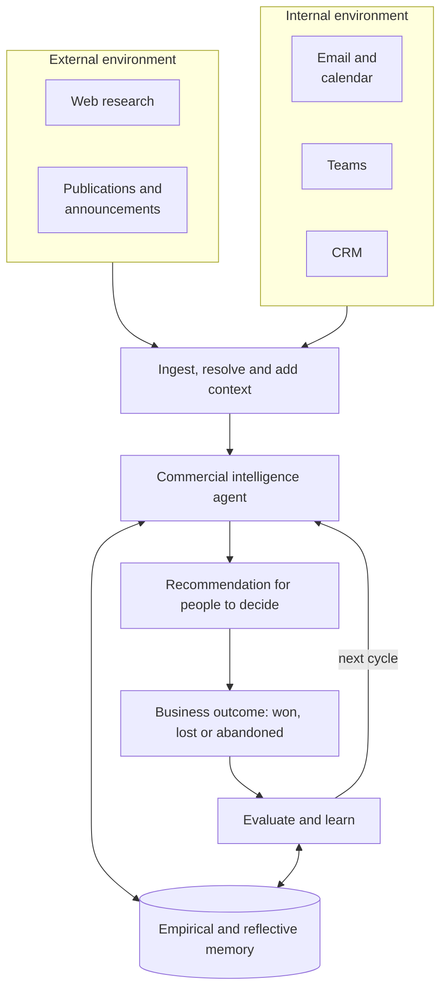

[Part 2](intelligence-that-compounds-2-what-it-means.html) followed a system through 60 sessions of experience: its confidence built, failed, and settled; its loss fell by 10.3% from the first stage to the last; and because it still did not beat a baseline that never learned, its governance declined to adopt it. This part asks what that means beyond one market: for the people who build and review systems like this, for who should own each kind of learning, and for an organisation that wants to learn from its own decisions rather than only record them.

## What it means in practice

Sixty sessions say little about Brent. They say a good deal about systems that learn.

**Experience has to be recorded as decisions.** Seven weeks of scheduled market commentary had produced plenty of analysis and almost nothing to learn from. Sixty sessions of recorded forecasts produced 180 scored comparisons. The difference was not intelligence; it was whether each judgement was written down, with its confidence, before the outcome was known. Most organisations are in the first position: rich in commentary, poor in decisions that can be checked.

**Adapting and improving are separate measurements.** The adaptive strategy changed its behaviour as it learned, and got better at every stage. Only a comparison with a baseline that never learned showed that it was still not good enough. Without that baseline, the 10.3% would have been reported as success. Any claim that an AI system has improved should come with the answer to one question: compared with what, on the same cases?

**How fast a system learns is a design decision.** The adaptive strategy remembered everything and adjusted slowly; it kept expecting rises through five consecutive falls. The regime-sensitive strategy reacted at once and was repeatedly caught by reversals. Neither is right in general. Choosing how much weight new experience should carry is a judgement about the domain, and it belongs to the people who understand it.

**Confidence has to be earned, and measured.** Both strategies lost most heavily when they were most confident. In the ten sessions where the regime-sensitive strategy was at least 65% sure of a rise, averaging 72.6%, Brent rose six times. The Brier score rewards honest uncertainty; most management dashboards reward the confident call. An organisation that adopts learning systems has to decide which behaviour it wants, and measure accordingly.

**The cost of building has collapsed; the cost of judging has not.** The database, the workspace and the experiment were built by conversation. The most valuable hours went into reviewing the design, where eight problems were found, each of which would have quietly flattered the results. In an organisation, that changes where AI effort should be budgeted: less on building, more on review, measurement and ownership.

**Shared work needs access decisions.** Moving the system's interpretation into Notion turned a private experiment into something a team can read, question and comment on. It also made every sharing setting a decision about who may see, and who may change, what the system has learned.

**A personal setup has personal limits.** The experiment runs on one person's accounts, with plugins that act with that person's rights. That is acceptable for an experiment and not for an organisation, which is where the rest of this part goes.

### What Notion adds

Because the agent's interpretation lives in Notion, the experiment gains things a database alone would not give it.

**It can be shared.** A Notion page can be shared with chosen colleagues or guests at a chosen permission level, or published to the web. [Notion](https://www.notion.com/help/sharing-and-permissions) The research becomes something a team reads, not a file one person keeps.

**It can be discussed where it is written.** Readers can comment on a whole page or on a specific sentence. [Notion](https://www.notion.com/help/comments-mentions-and-reminders) A colleague who doubts a hypothesis can say so next to it, and the weekly review becomes a conversation in place rather than a meeting about a document.

**It can be questioned.** Notion AI answers questions from the pages in a workspace that the person asking has access to, and follows the workspace's access rules. [Notion](https://www.notion.com/help/notion-ai-faqs) Anyone on the team can ask which hypotheses are waiting for a decision, or why the regime-sensitive strategy was not promoted, without reading every page.

Each of these has a governance edge. Sharing is an access decision: share the dashboards widely, but keep the Decisions page editable by its owner alone. Notion AI answers from Notion, which holds the interpretation; the numbers that count are in Supabase, and a dashboard figure should be checked against them before it is quoted. And Notion's own agent can create and edit pages, which makes it one more writer in the workspace to account for.

## Who decides what an agent learns

[Designing Agency](designing-agency-0-permission.html) asked what we are giving an agent permission to do. A learning agent raises a further question: *if we authorise an agent to do a task, have we also authorised it to change how it does it?*

Organisational learning offers a useful distinction, introduced by Chris Argyris. *Single-loop learning* corrects actions within the existing rules, like a thermostat that switches the heating on when the room is cold. *Double-loop learning* questions the rules themselves, such as whether that is the right temperature. [Wikipedia](https://en.wikipedia.org/wiki/Double-loop_learning) In this agent, adjusting a prediction is single-loop. Changing its analytical strategy is double-loop. Changing its objectives, or the way its success is measured, is a loop that should stay with people.

So the answer is: partly. It may propose and test new strategies. It may not change its objectives, its scoring or its permissions, because an agent that can rewrite how it is judged can always declare itself improved. Promotion stays a human decision, recorded and reversible.

The experiment in Part 2 followed exactly that division. The strategies adjusted their own probabilities, single-loop, freely. Changing which strategy the system runs, double-loop, was proposed, measured and refused. The scoring rule and the objective were never the agent's to touch.

## Extending it to an organisation

Brent is a useful teacher because the market publishes an independent outcome every day. Organisations generate far more experience than that, but it is scattered across email, meetings, chat, the CRM, documents and operational systems, and almost none of it is connected to what happened next.

What would the same architecture look like for a commercial team? This is a proposal, not something I have built. The connections it relies on exist. ChatGPT has connected apps for Outlook email and calendar, Microsoft Teams and Gmail, each limited to what the connected account can already see. [OpenAI](https://help.openai.com/articles/12512241)[OpenAI](https://help.openai.com/articles/12552368)[OpenAI](https://help.openai.com/en/articles/10291617-tasks-in-chatgpt) HubSpot's connector for ChatGPT can answer questions about CRM data, create and update records such as contacts and deals, and log activities, within the user's existing HubSpot permissions. [HubSpot](https://knowledge.hubspot.com/integrations/connect-your-hubspot-account-to-chatgpt)

| Source | What it contributes |
|---|---|
| Email | Customer conversations, objections, commitments |
| Teams | Internal discussion, dependencies, context |
| Calendar | Meetings and engagement history |
| CRM | Opportunities, stages, customers and commercial outcomes |
| Web research | Competitor news, announcements, market developments |
| Empirical memory | Observations, recommendations, actions taken and outcomes |
| Reflective memory | Commercial hypotheses, lessons, briefings |

The aim is not to summarise these systems. It is to learn from the relationships between outside events, internal activity, decisions and eventual outcomes.

A fictional example. An industrial automation company's agent finds that a manufacturer has announced a $50 million production expansion. The CRM shows the manufacturer is an existing customer, with no open automation opportunity. Email from last year shows interest in automated quality inspection. A Teams thread shows the engineering team has just finished a relevant solution. The agent connects the four and recommends that sales open a conversation about quality inspection for the new plant, recording its evidence, assumptions and confidence, exactly as the Brent agent records a forecast.

The sales team decides whether to act. If an opportunity is created, the agent follows it through the CRM until it is won, lost or abandoned, and records the result. Over many such cases it can begin to ask better questions. Which announcements tend to precede real opportunities? Which signals mislead? Which sources see things first? Which recommendations lead to genuine engagement?

One caution matters more than any other. An opportunity being won does not show that the recommendation caused it. The customer may have called anyway. Claims about cause need stronger designs, such as comparison groups or controlled trials, and should be made sparingly.

That caution marks the difference between three levels of learning:

- **Predictive learning:** getting better at saying what will happen. Will Brent rise? Will this deal close? Is this customer relationship deteriorating?
- **Intervention learning:** finding which actions make good outcomes more likely, such as resolving an objection early or involving engineering at the right moment. This needs a record of which recommendations were actually followed, and which were not.
- **Organisational learning:** using validated experience to improve how the organisation itself works: research practices, recurring bottlenecks, escalations that never help, handovers between sales and engineering.

At the third level the system stops being only a tool that performs tasks and becomes a way of understanding how those tasks are done.

*Figure 1. The proposed commercial architecture. Internal and external sources converge; recommendations go to people; business outcomes flow back as the evidence for learning.*

*Alt text: Web research and publications from the external environment, and email, calendar, Teams and the CRM from the internal environment, are ingested, resolved and given context. They feed a commercial intelligence agent, which makes recommendations for people to decide on. The business outcome, won, lost or abandoned, goes to evaluation and learning, which feeds the next cycle. The agent and evaluation share empirical and reflective memory.*

### Connecting is not understanding

A connected application gives access to information. It does not establish what the information means, how pieces relate or which to believe.

| Challenge | Example |
|---|---|
| Entity resolution | Linking an email thread to the right customer and the right opportunity |
| Time | Knowing what was known when a recommendation was made |
| Events | Telling an informal remark from a confirmed commitment |
| Duplicates | Recognising one event reported in email, Teams and the CRM |
| Authority | Deciding which system wins when they disagree |
| Outcomes | Telling a reported status from a verified result |
| Boundaries | Respecting existing access rights and confidentiality |
| Untrusted content | Stopping a web page or an email from acting as an instruction |

Every one of these has a Brent equivalent that was easier. A futures contract has one name; a customer may have five. A settlement price is published; a deal's real status is often only in someone's head. The barrier to building has fallen. The questions of evidence and governance have not.

### What changes when it belongs to an organisation

The governance that was a personal discipline in the Brent experiment has to become an organisational one.

**Separate identities.** In the experiment, the agent acts through its owner's accounts, so it could in principle change what its owner approved. In an organisation, the agent needs an identity of its own, and the person who approves its changes needs a different one, as [Whose authority is it acting on?](designing-agency-3-whose-authority.html) describes. Approval that the agent could have given itself is not approval.

**Read first, write later.** Start with read-only access to the information the agent is allowed to see. Messages to customers, CRM updates and anything else with consequences should wait for a person. The tools support this, and sometimes require it: HubSpot notes that records created through its connector bypass custom validation rules, including pipeline stage checks, and recommends setting its write tools to require approval. [HubSpot](https://knowledge.hubspot.com/integrations/connect-your-hubspot-account-to-chatgpt)

**Permissions follow the people, not the agent.** The connected apps work within the access their users already have, which is the right default and also a limit: an agent that learns from one sales manager's mailbox learns from one sales manager's view of the world. Which mailboxes, channels and records feed the learning is a decision for the business, not a side effect of who installed the plugin.

**Owners for the things that matter.** Someone owns the objective, someone owns the scoring, and someone owns the decision to adopt a change, and they should not all be the agent. [When the role is wrong](designing-agency-8-when-the-role-is-wrong.html) argued that agent roles and policies should be treated as changes to be reviewed; strategies a learning agent proposes belong in the same discipline.

**A slower clock.** Brent produces an outcome every day. A sales cycle may take months. Evidence accumulates more slowly, so the temptation to promote a change on a handful of wins is stronger, and the rule for promotion matters more.

### How far along an organisation is

These ideas can be arranged as a progression. It is a proposed scale, not an industry standard.

| Level | Capability |
|---|---|
| 1 · Stateless | Answers requests, keeps nothing |
| 2 · Connected | Reaches outside applications and information |
| 3 · Persistent | Keeps observations, decisions and outcomes |
| 4 · Reflective | Examines its record and forms hypotheses |
| 5 · Adaptive | Tests changes and adopts only validated ones |
| 6 · Institutional | Turns validated experience into knowledge others reuse |

This is a proposed scale, not an industry standard. Connecting applications reaches level 2, and level 3 is now easy to build. The real work is the step from 4 to 5, where a claim has to become a measurement.

Level 6, turning validated experience into knowledge the whole organisation reuses, is where institutional intelligence begins, and it depends less on the agent than on whether the organisation is willing to be measured.

## Intelligence that compounds

Most enterprise systems are designed to record what an organisation does. The question this series has asked is whether we can design systems that help an organisation learn from what it does.

This series began with a claim from all three series on this blog: an agent must be able to reason correctly, act within delegated authority, and learn from consequences without compromising either. The principle behind the third part of that claim stays the same at every scale. Agency lets an agent act. Observation lets it see its environment. Memory lets it keep experience. Reflection lets it question its understanding. Evaluation establishes whether an improvement is real. Governance decides which improvements it may adopt.

The experiment showed that sequence working end to end. Memory enabled adaptation: the system's decisions changed, session by session, as its experience grew. Evaluation established that the adaptation was real and not yet enough. Governance declined to adopt it and chose the next experiment from the evidence. A system that could not reach that conclusion would have adopted its luckiest guess.

Building an agent with memory is now straightforward; this one was built by conversation. Building one that can show it improves through experience is a different and harder problem, and most of it is not technical. Connecting more tools gives an agent more information. Designing a learning loop gives it a chance to get better at using that information. The opportunity is not only to build more capable agents, but to build organisations in which intelligence, human and artificial, compounds.

The next experiment is already registered: a confidence-adjusted strategy, tested forward against the same baseline, followed by forecasts informed by research and model reasoning. I will report the results here when there are enough of them to mean something, whichever way they point.

:::question
**A question to sit with.** Which decision in your organisation produces an outcome you could record within a month, and who would review what an agent learned from it?
:::

## Sources

- Notion, [*Sharing and permissions*](https://www.notion.com/help/sharing-and-permissions), [*Comments, mentions and reactions*](https://www.notion.com/help/comments-mentions-and-reminders) and [*Notion AI FAQs*](https://www.notion.com/help/notion-ai-faqs), accessed November 2026.
- OpenAI Help Center, [*Outlook Email and Calendar apps in ChatGPT*](https://help.openai.com/articles/12512241), [*Microsoft Teams app and setup in ChatGPT*](https://help.openai.com/articles/12552368) and [*Scheduled tasks in ChatGPT*](https://help.openai.com/en/articles/10291617-tasks-in-chatgpt), accessed November 2026.
- HubSpot Knowledge Base, [*Set up and use the HubSpot connector for ChatGPT*](https://knowledge.hubspot.com/integrations/connect-your-hubspot-account-to-chatgpt), accessed November 2026.
- Wikipedia, [*Double-loop learning*](https://en.wikipedia.org/wiki/Double-loop_learning).
