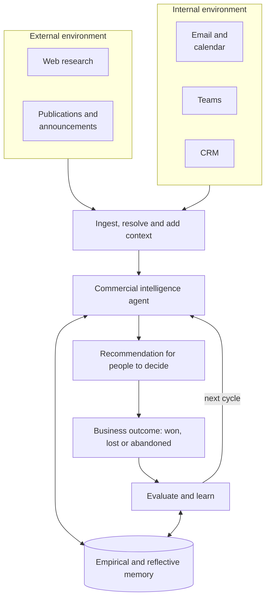

The experiment in [Part 2](intelligence-that-compounds-2-what-it-means.html) taught me very little about oil and a fair amount about building systems that learn. Its adaptive strategy reduced its loss by 10.3% over 60 sessions and still did not beat a baseline that never learned, so it was not adopted. In this part I want to work through what that implies for the enterprise systems I spend most of my time on, where the decisions are commercial, the outcomes take months to arrive, and a change in an agent's behaviour affects other people's work.

## What the experiment changed in my thinking

The first lesson is about records. My monitoring workflow had produced seven weeks of Brent commentary and almost nothing I could learn from, while 60 sessions of recorded forecasts produced 180 scored comparisons. The analysis in the commentary was not worse; the difference was that each forecast was written down, with a probability, before its outcome was known. Many organisations are in the first position. They have a great deal of commentary in emails, meeting notes and status reports, and very few decisions recorded in a form that could later be checked.

The second is reproducibility. Using the original price observations, the initial conditions and the adaptation rules, both learning strategies can be reconstructed across all 60 sessions, including every forecast probability and every evaluation score. As [Part 1](intelligence-that-compounds-1-building-it.html) describes, the reconstruction only succeeded once the regime-sensitive strategy's initial state, the market's fall on 24 August, was restored, which is why the design now treats initial state, accumulated experience and adaptation rules as part of the empirical record.

For an enterprise AI system this is a useful architectural property. If the state that informed a decision is preserved, it becomes possible to investigate how that decision was reached and how accumulated experience influenced the system's later behaviour. Reproduction was straightforward here because the learning is deterministic arithmetic. A strategy revised by a language model would not replay to the same output, so the record has to preserve the decision's context instead: the strategy version, the cutoff time, the evidence available before it, and the instructions and model used. The design in Part 1 already records the first three, along with a run key for every execution; the instructions and model version would need to be added. That context is what an audit or an incident review in an organisation would need in order to understand why an agent behaved as it did.

The third is that adapting and improving need separate measurements. The adaptive strategy changed its behaviour with experience and improved in each block of sessions. Without the fixed baseline, I would have reported the 10.3% as a success. When someone tells me that an AI system has improved, the first thing I now want to know is what it was compared with, and whether the comparison was on the same cases.

The fourth concerns speed. How quickly a system learns turned out to be a design decision with real consequences. The adaptive strategy remembered everything and adjusted slowly, so it kept expecting rises through five consecutive falls. The regime-sensitive strategy reacted at once and was repeatedly caught by reversals. Neither setting is right in general. Deciding how much weight new experience should carry depends on how stable the domain is, and that is a judgement for people who understand the domain, not something to leave as a default.

Confidence was the fifth. Both strategies lost most heavily when they were most confident. In the ten sessions where the regime-sensitive strategy estimated the probability of a rise at 65% or higher, its average forecast was 72.6% and the price rose in 60% of them. The adaptive strategy erred in the opposite direction, underestimating rises in the sessions where it leaned towards a fall. The Brier score rewards a system for being honest about uncertainty. Most management dashboards reward the confident call, and an organisation adopting learning systems will have to decide which behaviour it actually wants to encourage.

Finally, building was cheap and judging was not. The database, the workspace and the experiment were built by conversation, and the hours that mattered went into reviewing the design, where I found eight problems that would each have made the results look better than they were. If that holds more generally, organisations should be budgeting their AI effort quite differently, with much less going into construction and much more into review, measurement and clear ownership.

### What Notion adds, and what it complicates

Putting the system's interpretation in Notion has consequences beyond storage. The most obvious is that it can be shared. A Notion page can be shared with chosen colleagues or guests at a chosen permission level, or published to the web, [Notion](https://www.notion.com/help/sharing-and-permissions) so the learning journal becomes something a team can read instead of a file one person keeps.

It can also be discussed where it is written. Readers can comment on a whole page or on a specific sentence, [Notion](https://www.notion.com/help/comments-mentions-and-reminders) so a colleague who doubts a hypothesis can say so next to it, and a weekly review can happen in the document itself. And it can be queried. Notion AI answers questions from the pages in a workspace that the person asking has access to, following the workspace's access rules, [Notion](https://www.notion.com/help/notion-ai-faqs) which means someone on the team can ask which hypotheses are waiting for a decision, or why the regime-sensitive strategy was not promoted, without reading every page.

Each of these needs a governance decision of its own. Sharing is an access decision: I would share the dashboards widely and keep the Decisions page editable by its owner alone. Notion AI answers from Notion, which holds the interpretation, while the numbers that count are in Supabase, so any figure from a dashboard should be checked there before it is quoted. Notion's own agent can also create and edit pages, which makes it one more writer in the workspace that the design has to account for.

## Who decides what an agent learns

In [Designing Agency](designing-agency-0-permission.html) I asked what we are actually giving an agent permission to do. A learning agent raises a further question, which the prologue left open: if we authorise an agent to carry out a task, have we also authorised it to change how it carries it out?

The most useful framework I have found for this comes from organisational learning. Chris Argyris distinguished *single-loop learning*, which corrects actions within the existing rules, like a thermostat switching the heating on when a room is cold, from *double-loop learning*, which questions the rules themselves, such as whether that is the right temperature to aim for. [Wikipedia](https://en.wikipedia.org/wiki/Double-loop_learning) In this agent, adjusting a forecast is single-loop learning. Changing its analytical strategy is double-loop learning. Changing its objectives, or how its success is measured, is a further loop again, and I think that one should stay with people.

My answer to the authorisation question is therefore a partial yes. The agent may propose and test new strategies. It may not change its objectives, its scoring or its permissions, because an agent that can change how it is judged can always find a way to declare itself improved. Promotion remains a human decision, recorded and reversible.

The experiment in Part 2 followed that division without my having to intervene. The strategies adjusted their own probabilities freely, which is single-loop learning. A change of strategy, which is double-loop, was proposed, measured and declined. The scoring rule and the objective were never within the agent's reach.

## Extending it to an organisation

Brent was a convenient teacher because the market publishes an independent outcome every day. Organisations generate far more experience than that, but it is scattered across email, meetings, chat, the CRM, documents and operational systems, and very little of it is ever connected to what happened next.

I have sketched what the same architecture might look like for a commercial team. This is a design I have not built. The connections it relies on do exist: ChatGPT has connected apps for Outlook email and calendar, Microsoft Teams and Gmail, each limited to what the connected account can already see, [OpenAI](https://help.openai.com/articles/12512241)[OpenAI](https://help.openai.com/articles/12552368)[OpenAI](https://help.openai.com/en/articles/10291617-tasks-in-chatgpt) and HubSpot's connector for ChatGPT can answer questions about CRM data, create and update records such as contacts and deals, and log activities, within the user's existing HubSpot permissions. [HubSpot](https://knowledge.hubspot.com/integrations/connect-your-hubspot-account-to-chatgpt)

| Source | What it contributes |
|---|---|
| Email | Customer conversations, objections, commitments |
| Teams | Internal discussion, dependencies, context |
| Calendar | Meetings and engagement history |
| CRM | Opportunities, stages, customers and commercial outcomes |
| Web research | Competitor news, announcements, market developments |
| Empirical memory | Observations, recommendations, actions taken and outcomes |
| Reflective memory | Commercial hypotheses, lessons, briefings |

Summarising these systems would add little. What I am interested in is whether a system can learn from the relationships between outside events, internal activity, decisions and eventual outcomes.

A fictional example makes the mechanism concrete. An industrial automation company's agent finds that a manufacturer has announced a $50 million production expansion. The CRM shows the manufacturer is an existing customer with no open automation opportunity. Email from the previous year shows interest in automated quality inspection, and a Teams thread shows that the engineering team has just finished a relevant solution. The agent connects the four and recommends that sales open a conversation about quality inspection for the new plant, recording its evidence, assumptions and confidence in the same way the Brent system records a forecast.

The sales team decides whether to act. If an opportunity is created, the agent follows it through the CRM until it is won, lost or abandoned, and records the result. Over many such cases it could start to answer more useful questions: which announcements tend to come before real opportunities, which signals mislead, which sources see things first, and which recommendations lead to genuine engagement.

The caution I would put first is about cause. An opportunity being won does not show that the recommendation produced it, since the customer may have called anyway. Claims about cause need stronger designs, such as comparison groups or controlled trials, and should be made sparingly. That caution separates three levels of learning. The first is predictive: getting better at saying what will happen, whether that is a move in Brent, a deal closing or a customer relationship deteriorating. The second is about interventions, finding which actions make good outcomes more likely, such as resolving an objection early or involving engineering at the right moment, and it needs a record of which recommendations were actually followed. The third is organisational, using validated experience to improve how the organisation itself works, including its research practices, recurring bottlenecks, escalations that never help and handovers between sales and engineering. At that third level the system is doing more than performing tasks; it is helping the organisation understand how its tasks get done.

*Figure 1. The proposed commercial architecture. Internal and external sources converge; recommendations go to people; business outcomes flow back as the evidence for learning.*

*Alt text: Web research and publications from the external environment, and email, calendar, Teams and the CRM from the internal environment, are ingested, resolved and given context. They feed a commercial intelligence agent, which makes recommendations for people to decide on. The business outcome, won, lost or abandoned, goes to evaluation and learning, which feeds the next cycle. The agent and evaluation share empirical and reflective memory.*

### Connecting is the easy part

A connected application gives an agent access to information. It does not tell the agent what the information means, how the pieces relate or which of them to believe, and that is where most of the work in an enterprise version would go.

| Challenge | Example |
|---|---|
| Entity resolution | Linking an email thread to the right customer and the right opportunity |
| Time | Knowing what was known when a recommendation was made |
| Events | Telling an informal remark from a confirmed commitment |
| Duplicates | Recognising one event reported in email, Teams and the CRM |
| Authority | Deciding which system wins when they disagree |
| Outcomes | Telling a reported status from a verified result |
| Boundaries | Respecting existing access rights and confidentiality |
| Untrusted content | Stopping a web page or an email from acting as an instruction |

Every one of these has an equivalent in the Brent system, and every Brent version was easier. A futures contract has one name, where a customer may have five. A settlement price is published, where a deal's real status is often only in someone's head. The tooling has removed most of the effort of building, but these questions of evidence and governance are still as hard as they were.

### What changes when the system belongs to an organisation

Much of the governance in the Brent experiment was personal discipline, and in an organisation it would have to become structure.

The agent and its approver need separate identities. In the experiment the agent acts through my accounts, so in principle it could change something I had approved. An organisational agent needs an identity of its own, and the person who approves its changes needs a different one, as [Whose authority is it acting on?](designing-agency-3-whose-authority.html) describes. An approval the agent could have given itself is not worth much.

I would also start with read-only access to the information the agent is allowed to see, and keep messages to customers, CRM updates and anything else with consequences waiting for a person. The tools support this and in places require it: HubSpot notes that records created through its connector bypass custom validation rules, including pipeline stage checks, and recommends setting its write tools to require approval. [HubSpot](https://knowledge.hubspot.com/integrations/connect-your-hubspot-account-to-chatgpt)

Permissions are a subtler problem. The connected apps work within the access their users already have, which is the right default but also a limitation: an agent that learns from one sales manager's mailbox learns from one sales manager's view of the world. Which mailboxes, channels and records feed the learning should be a business decision rather than a side effect of who happened to install the plugin.

Ownership needs to be explicit too. Someone should own the objective, someone the scoring and someone the decision to adopt a change, and none of them should be the agent. In [When the role is wrong](designing-agency-8-when-the-role-is-wrong.html) I argued that agent roles and policies should be treated as changes to be reviewed, and the strategies a learning agent proposes belong in the same process.

The last difference is the clock. Brent produced an outcome every session, while a sales cycle can take months. Evidence builds up more slowly, the temptation to promote a change after a handful of wins is stronger, and the rule for promotion matters correspondingly more.

### A rough scale of maturity

I find it useful to arrange these capabilities as a progression. It is my own working scale rather than an industry standard.

| Level | Capability |
|---|---|
| 1 · Stateless | Answers requests, keeps nothing |
| 2 · Connected | Reaches outside applications and information |
| 3 · Persistent | Keeps observations, decisions and outcomes |
| 4 · Reflective | Examines its record and forms hypotheses |
| 5 · Adaptive | Tests changes and adopts only validated ones |
| 6 · Institutional | Turns validated experience into knowledge others reuse |

Connecting applications gets an organisation to level 2, and level 3 is now easy to build. Most of the real work is the step from 4 to 5, where a claim about improvement has to become a measurement. Level 6, where validated experience becomes knowledge the wider organisation reuses, depends less on the agent than on whether the organisation is willing to have its own decisions measured.

## Where this leaves me

Most enterprise systems are designed to record what an organisation does. The question behind this series has been whether we can design systems that help an organisation learn from what it does, without weakening the reasoning and the delegated authority that the two earlier series on this blog were concerned with.

The experiment showed the sequence working end to end on a small scale. Recording decisions before their outcomes let the system's behaviour change with experience. Evaluation against a fixed baseline showed that the change was real and not yet sufficient. Governance declined to adopt it and chose the next experiment from the evidence. A system without those last two steps would have adopted its luckiest guess.

Building an agent with memory is now straightforward; this one was built by conversation. Showing that an agent improves through experience is a different problem, and most of it is not technical. It needs decisions recorded in a checkable form, baselines that do not move, and people who own the decision to change. My working thesis is unchanged by the results: intelligence compounds when experience is preserved, later decisions are informed by it, outcomes are evaluated independently, and adaptations are subject to governance.

The next experiment is already registered: a confidence-adjusted strategy, tested forward against the same baseline, followed by forecasts informed by research and model reasoning. I will report the results here when there are enough of them to mean something, whichever way they point.

## Sources

- Notion, [*Sharing and permissions*](https://www.notion.com/help/sharing-and-permissions), [*Comments, mentions and reactions*](https://www.notion.com/help/comments-mentions-and-reminders) and [*Notion AI FAQs*](https://www.notion.com/help/notion-ai-faqs), accessed November 2026.
- OpenAI Help Center, [*Outlook Email and Calendar apps in ChatGPT*](https://help.openai.com/articles/12512241), [*Microsoft Teams app and setup in ChatGPT*](https://help.openai.com/articles/12552368) and [*Scheduled tasks in ChatGPT*](https://help.openai.com/en/articles/10291617-tasks-in-chatgpt), accessed November 2026.
- HubSpot Knowledge Base, [*Set up and use the HubSpot connector for ChatGPT*](https://knowledge.hubspot.com/integrations/connect-your-hubspot-account-to-chatgpt), accessed November 2026.
- Wikipedia, [*Double-loop learning*](https://en.wikipedia.org/wiki/Double-loop_learning).
