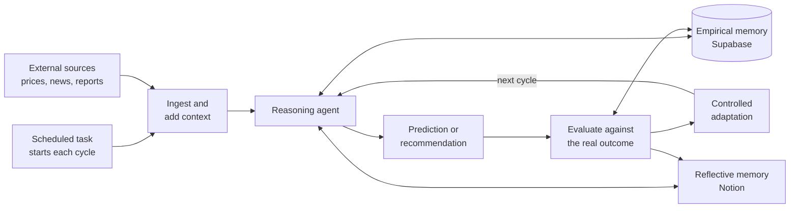
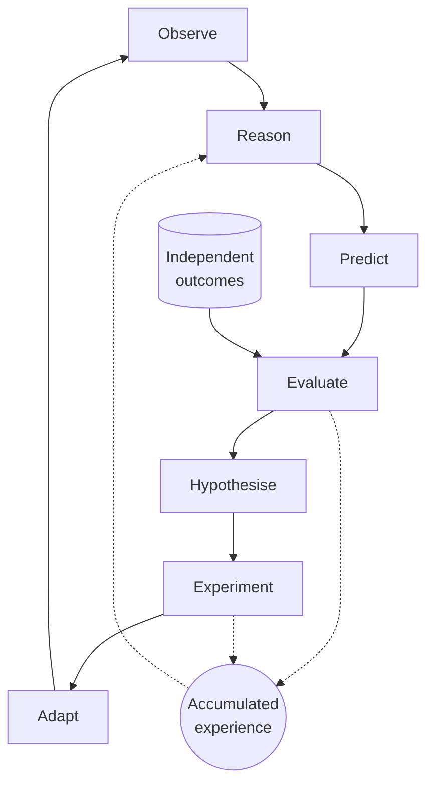

Imagine a colleague who is exceptionally capable. Every morning they gather information, analyse the situation and make recommendations. But they never check whether yesterday's recommendations were right, and never ask why one approach worked and another failed. Every morning, for all their intelligence, they start again.

Many AI assistants work this way. We have given them knowledge, tools and the ability to act, but rarely a way to learn from consequences.

Memory alone is not learning. Reflection alone is not improvement. And self-improvement without measurement is only a claim.

This series explores a proposition: an AI system can get better at a task without changing the underlying model. What has to evolve is the architecture around it: its memory, its strategies, its evaluation, and its ability to build up experience that has been checked.

## A small experiment

I have been exploring this with a small market intelligence agent, assembled from ChatGPT's scheduled tasks, a Supabase database and a Notion workspace. There is no application: every piece is an existing platform, configured.

It follows one thing, Brent crude oil, and answers one question every trading day: *which way will Brent move next, how confident is it, and why?*

Any capable assistant can research the market and answer that. The difference is what happens afterwards. The agent keeps its prediction, its evidence, its confidence and the version of the strategy it used. When the real price is known, it goes back, measures the gap and writes down possible explanations, which become hypotheses to test.

This is an experiment in architecture, not a forecasting claim or investment advice. The question it makes concrete: what would it take for a system like this to *show* that it is improving?

*Figure 1. A loop, not a pipeline: each cycle ends by checking against reality.*

*Alt text: A scheduled task starts each cycle. External sources are ingested and given context, then passed to a reasoning agent, which makes a prediction or recommendation. That is evaluated against the real outcome, which leads to controlled adaptation and back to the agent for the next cycle. The agent reads and writes empirical memory in Supabase and reflective memory in Notion; evaluation reads and writes empirical memory and writes to reflective memory.*

## Two kinds of memory

The design rests on keeping two kinds of memory apart.

**Supabase holds the evidence:** what was observed, what was predicted, with what confidence, and what actually happened. These records are never rewritten once the outcome is known, because a system that can edit its own history can always look like it is improving.

**Notion holds the interpretation:** research notes, explanations, hypotheses and proposed changes to the strategy.

The difference matters. A hypothesis does not become knowledge because an AI wrote it down. Recent research names the danger: agents that reflect on their own work can endorse their mistakes and store them as guidance, a *self-confirmation trap*. [Zhu et al.](https://arxiv.org/abs/2606.24428) Only evaluation against outcomes the agent does not control should turn an idea into practice.

## One wrong prediction

Suppose that on Monday the agent sees a supply disruption and predicts Brent will rise 1.5%, with 80% confidence. Brent falls 0.8%.

An ordinary assistant simply writes Tuesday's analysis. This one asks whether it overweighted supply and underweighted weakening demand, and records a hypothesis: *supply shocks may matter less when demand is falling.*

The hypothesis is not adopted. One wrong prediction proves nothing. It is recorded, compared with similar past cases, and tested: a revised strategy runs alongside the current one, on days neither has seen. It is promoted only if it does better over enough of them. That is the difference between an agent that remembers and an agent designed to learn.

*Figure 2. The learning loop. Evaluation uses outcomes from outside the agent, not its opinion of itself.*

*Alt text: A cycle: observe, reason, predict, evaluate, hypothesise, experiment, adapt, and back to observe. Independent outcomes feed into evaluate. Accumulated experience sits at the centre: evaluation and experiments add to it, and reasoning draws on it.*

## What improves, and how we would know

Nothing here retrains the model. What changes is everything around it: which sources it reads, how it weighs signals, how well its confidence matches reality. Research such as Reflexion and ExpeL has shown agents improving on benchmark tasks through written reflection, without changing the model's weights. [Shinn et al.](https://arxiv.org/abs/2303.11366)[Zhao et al.](https://arxiv.org/abs/2308.10144) Whether that holds in a noisy market is exactly what has to be measured.

Measuring it honestly means comparing the agent with simple baselines, storing every prediction before the outcome exists, and testing only on days after those a strategy was developed on. I have no results yet that meet that standard. The architecture's claim is narrower: it makes the question answerable.

## Who decides what it learns

[Designing Agency](designing-agency-0-permission.html) asked what we are giving an agent permission to do. A learning agent raises a new question: *if we authorise an agent to do a task, have we also authorised it to change how it does it?*

Partly. It may propose and test new strategies. It may not change its objectives, its scoring or its permissions: an agent that can rewrite how it is judged can always declare itself improved. Promotion stays a human decision, recorded and reversible.

## Beyond oil

Brent is a convenient teacher because the market publishes an independent outcome every day. Organisations hold far more experience, scattered across email, meetings and the CRM, and rarely connected to what happened next. The same pattern could link a sales team's signals and recommendations to deals won or lost, remembering that a win after a recommendation does not prove the recommendation caused it.

| Level | Capability |
|---|---|
| 1 · Stateless | Answers requests, keeps nothing |
| 2 · Connected | Reaches outside applications and information |
| 3 · Persistent | Keeps observations, decisions and outcomes |
| 4 · Reflective | Examines its record and forms hypotheses |
| 5 · Adaptive | Tests changes and adopts only validated ones |
| 6 · Institutional | Turns validated experience into knowledge others reuse |

This is a proposed scale, not an industry standard. Connecting applications reaches level 2, and level 3 is now easy to build. The real work is the step from 4 to 5, where a claim has to become a measurement.

## Next: building it

Connecting tools gives an agent more information. Designing a learning loop gives it a chance to get better at using that information. [Part 1](intelligence-that-compounds-1-building-it.html) is the build, and most of it was done by conversation: ChatGPT designed the database, the engines and their prompts, and deployed them. What it could not do was decide what counts as evidence, and what the agent may change about itself.

:::question
**A question to sit with.** If an AI system in your organisation claimed it had improved last quarter, what evidence would you ask for, and does anything record it today?
:::

## Sources

- Shiding Zhu and colleagues, [*Beyond Self-Reflection: An Execute-Distill-Verify Framework for Agentic Experience Learning*](https://arxiv.org/abs/2606.24428), arXiv preprint, June 2026.
- Noah Shinn and colleagues, [*Reflexion: Language Agents with Verbal Reinforcement Learning*](https://arxiv.org/abs/2303.11366), arXiv preprint, 2023.
- Andrew Zhao and colleagues, [*ExpeL: LLM Agents Are Experiential Learners*](https://arxiv.org/abs/2308.10144), AAAI 2024.
