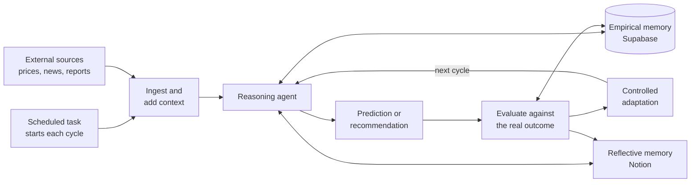
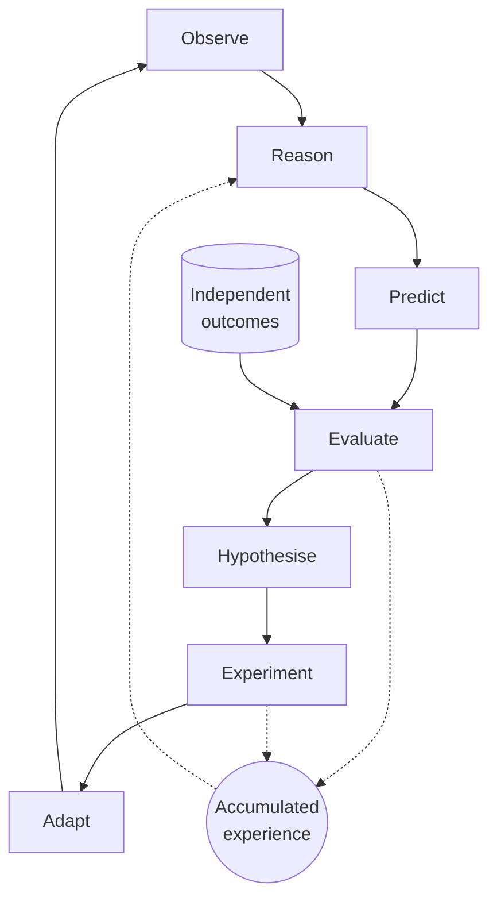

Imagine a colleague who is exceptionally capable. Every morning they gather information, analyse the situation and make recommendations. But they never check whether yesterday's recommendations were right, and never ask why one approach worked and another failed. Every morning, for all their intelligence, they start again.

Many AI assistants work this way. We have given them knowledge, tools, connected applications and, increasingly, the ability to act. We have rarely given them a way to learn from the consequences of what they recommend.

Memory alone is not learning. Reflection alone is not improvement. And self-improvement without measurement is only a claim.

This series explores a proposition: an AI system can get better at a task without changing the underlying model. What has to evolve is the architecture around it: its memory, its strategies, its evaluation, and its ability to build up experience that has been checked.

## Where this series fits

It is the third of three series on this blog, and each asks a different architectural question.

| Series | The question it asks |
|---|---|
| [Closing the Loop](neural-symbolic-loop.html) | How should an agent reason? |
| [Designing Agency](designing-agency-0-permission.html) | What should an agent be authorised to do? |
| Intelligence That Compounds | How should an agent learn from experience? |

Together they make one argument about enterprise AI: *an agent must be able to reason correctly, act within delegated authority, and learn from consequences without compromising either.* This series is about the third, and about why it cannot be allowed to undermine the first two.

## A small experiment

I have been exploring this with a small market intelligence agent, assembled from ChatGPT, a Supabase database and a Notion workspace, with Firecrawl for deeper research. There is no application to build; every piece is an existing platform, configured.

It follows one thing, Brent crude oil, and asks one question each trading day: *which way will Brent move next, how confident am I, and why?* Any capable assistant can answer that. The difference is what happens afterwards. The agent keeps its forecast, its evidence, its confidence and the version of the strategy it used, and when the real price is known it measures the gap.

The idea did not come from nowhere. Weeks of scheduled market watch had already produced plenty of analysis, and almost nothing that could be checked afterwards against what happened. That gap is what this series sets out to close.

This is an experiment in architecture, not a forecasting claim, and certainly not investment advice. Its purpose is to make one question concrete: what would it take for a system like this to *show* that it is improving?

*Figure 1. The architecture is a loop, not a pipeline: each cycle ends by checking against reality, and only tested changes feed the next cycle.*

*Alt text: A scheduled task starts each cycle. External sources are ingested and given context, then passed to a reasoning agent, which makes a prediction or recommendation. That is evaluated against the real outcome, which leads to controlled adaptation and back to the agent for the next cycle. The agent reads and writes empirical memory in Supabase and reflective memory in Notion; evaluation reads and writes empirical memory and writes to reflective memory.*

## The outcome the agent does not control

An agent cannot learn from a world it cannot observe, so what it reads matters. But the most important input is the easiest to overlook: an independent record of what actually happened. Without it, an agent can produce convincing explanations indefinitely and never discover whether it is getting better. In enterprise terms, the outcome is the system of record; the agent's own account of its performance is not.

The same discipline applies to time. Every piece of evidence needs to record when it was published, so that a prediction can only use what was known before it was made. An agent that justifies yesterday's call with today's news has not learned anything; it has rewritten the past.

## Two kinds of memory

The design rests on keeping two kinds of memory apart.

**Supabase holds the evidence:** what was observed, what was predicted, with what confidence, and what actually happened. These records are never rewritten once the outcome is known, because a system that can edit its own history can always look like it is improving.

**Notion holds the interpretation:** research notes, explanations, hypotheses and proposed changes to the strategy. It turns disconnected daily reports into a continuing line of inquiry, where today's analysis can build on last week's question.

The difference matters. A hypothesis does not become knowledge because an AI wrote it down. Recent research names the danger: agents that reflect on their own work can endorse their mistakes and store them as guidance, a *self-confirmation trap*. [Zhu et al.](https://arxiv.org/abs/2606.24428) Only evaluation against outcomes the agent does not control should turn an idea into practice.

*Figure 2. The learning loop. Evaluation draws on outcomes from outside the agent, not on the agent's opinion of its own performance.*

*Alt text: A cycle: observe, reason, predict, evaluate, hypothesise, experiment, adapt, and back to observe. Independent outcomes feed into evaluate. Accumulated experience sits at the centre: evaluation and experiments add to it, and reasoning draws on it.*

## What can improve

Nothing here retrains the model. What changes is everything around it: which sources it reads, how it weighs signals, how well its confidence matches reality, which past cases it recalls, and how it researches. Research such as Reflexion and ExpeL has shown agents improving on benchmark tasks through written reflection and extracted insights, without changing the model's weights. [Shinn et al.](https://arxiv.org/abs/2303.11366)[Zhao et al.](https://arxiv.org/abs/2308.10144) Whether that holds in a noisy market is exactly what has to be measured.

A professional analyst is a fair comparison. Their underlying abilities may not change much over a career; their methods, sources and judgement do, through experience and through being held to their record.

That raises the question the rest of the series has to answer. If we authorise an agent to do a task, have we also authorised it to change how it does it, and who decides which changes count as improvement?

## What the series covers

**[Part 1: Building it by conversation](intelligence-that-compounds-1-building-it.html)** is the build. ChatGPT designed the database, the engines and their prompts through its plugins for Supabase, Notion and Firecrawl, and built the parts the experiment needed. What it could not do was decide what counts as evidence, and what the agent may change about itself. The part covers the design, the eight problems a careful review found in it, and where a person's time actually goes.

**[Part 2: Adapting is not improving](intelligence-that-compounds-2-what-it-means.html)** is the evidence. The learning algorithm was actually executed over 60 historical trading sessions of Brent prices, one session at a time. On 10 September one of its strategies was 77.8% sure Brent would rise, and it rose by more than 10%. The next day it was 80% sure, and Brent fell. Did the system learn? Did it improve? And what did its governance decide? The answers are not the same, and the difference is the point.

**[Part 3: From one experiment to an organisation](intelligence-that-compounds-3-organisations.html)** is the meaning. What the experiment implies in practice, why single-loop and double-loop learning need different owners, how the same architecture would work for a commercial team, and what an organisation must change before it can trust a system that learns.

:::question
**A question to sit with.** If an AI system in your organisation claimed it had improved last quarter, what evidence would you ask for, and does anything record it today?
:::

## Sources

- Shiding Zhu and colleagues, [*Beyond Self-Reflection: An Execute-Distill-Verify Framework for Agentic Experience Learning*](https://arxiv.org/abs/2606.24428), arXiv preprint, June 2026.
- Noah Shinn and colleagues, [*Reflexion: Language Agents with Verbal Reinforcement Learning*](https://arxiv.org/abs/2303.11366), arXiv preprint, 2023.
- Andrew Zhao and colleagues, [*ExpeL: LLM Agents Are Experiential Learners*](https://arxiv.org/abs/2308.10144), AAAI 2024.
