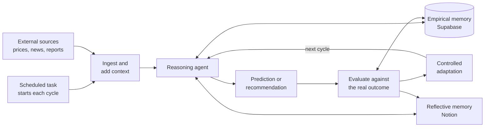
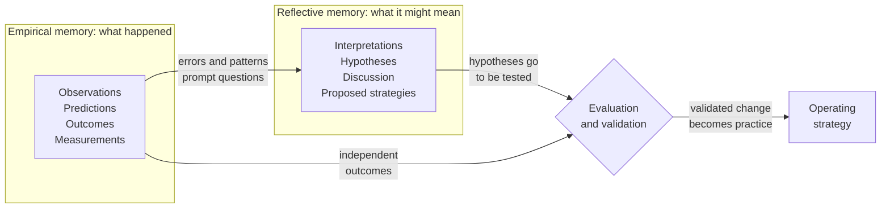
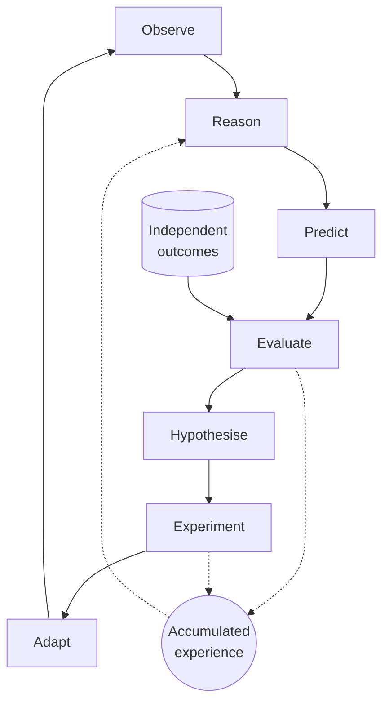
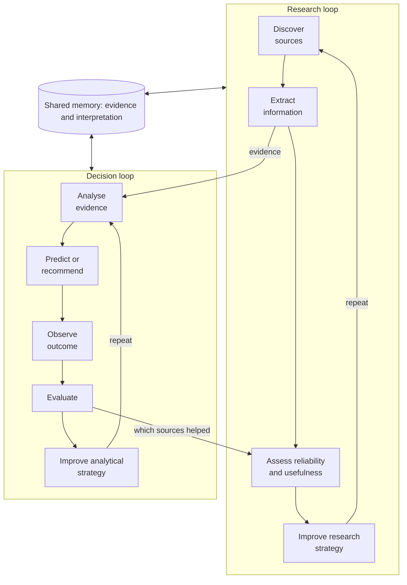
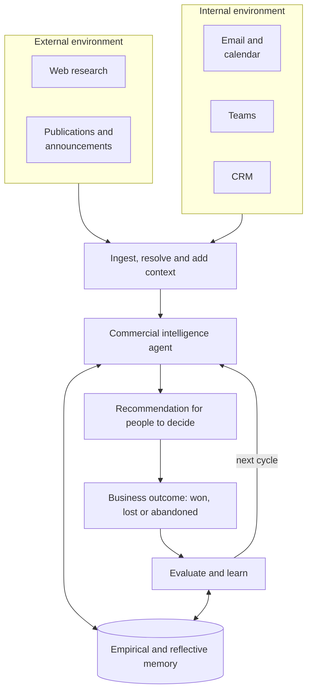
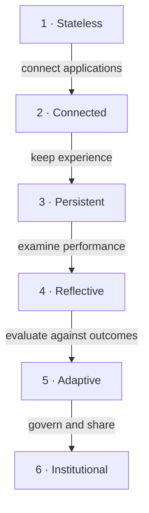

Imagine working with an exceptionally capable colleague. Every morning they gather information, analyse the situation and make recommendations. They are articulate, well read and quick to connect things nobody else had connected.

But they never check whether yesterday's recommendations were right. They do not measure the consequences of their advice, or ask why one approach worked and another failed. Every morning, for all their intelligence, they start again.

Many AI assistants work this way. We have given them knowledge, tools, connected applications and, increasingly, the ability to act. We have rarely given them a way to learn from the consequences of what they recommend.

Memory alone is not learning. Reflection alone is not improvement. And self-improvement without measurement is only a claim.

This article explores a proposition: an AI system can become better at a task without changing the underlying model. What has to evolve is the architecture around the model: its memory, its analytical strategies, its evaluation and its ability to accumulate experience that has been checked.

## A small experiment

I have been running a small experiment to explore this: a market intelligence agent assembled from ChatGPT, its scheduled tasks, a Supabase database and a Notion workspace. There is no application front end and no separately built orchestration framework. Everything is configured from existing platform capabilities.

To keep it simple, the agent follows one thing, Brent crude oil, and answers one question each day:

*What is the likely direction of Brent over the next trading session, and what evidence supports that view?*

Any capable assistant can research the market and answer that. The difference is what happens afterwards. The agent keeps its original prediction, the evidence and assumptions behind it, its stated confidence and the version of the analytical approach it used. When the actual outcome is known, it goes back to the prediction, examines the gap and writes down possible explanations, which become hypotheses for later analysis.

This is an experiment in architecture. It is not a claim that the agent forecasts oil better than anyone else, and it is not investment advice. Its purpose is to make one question concrete: what would it take for a system like this to show that it is getting better?

## Assembling it without writing an application

The pieces, and what each is for:

| Component | Responsibility |
|---|---|
| ChatGPT | Reasoning, research, orchestration and analysis |
| Scheduled tasks | A recurring cycle that runs without someone starting it |
| Market data | Prices, history and, later, the realised outcome |
| Supabase | Empirical memory: structured records of what was observed, predicted and measured |
| Notion | Reflective memory: research notes, hypotheses and the evolving interpretation |
| Evaluation | Measuring performance and testing proposed changes |
| Firecrawl (optional) | Deeper web searches and more sources, when ChatGPT's own research is not enough |

ChatGPT can run one-time or recurring tasks, [OpenAI](https://help.openai.com/en/articles/10291617-tasks-in-chatgpt) and use connected apps to search information or take supported actions in other services. [OpenAI](https://help.openai.com/en/articles/11487775-connectors-in-chatgpt) Supabase and Notion both publish servers for the Model Context Protocol, the common way to connect an AI assistant to an outside service. Supabase's lets an assistant query and work with a Postgres database; Notion's lets it search a workspace, create and edit pages, and manage databases. [Supabase](https://supabase.com/docs/guides/getting-started/mcp)[Notion](https://developers.notion.com/docs/mcp)

Code-free does not mean architecture-free. The system still needs data structures, instructions, permissions, evaluation criteria and operational controls, and each of those is a design decision. A small example: OpenAI's built-in Notion app lets ChatGPT search and read the pages a connected account can access. [OpenAI](https://help.openai.com/articles/12532955) An agent that only reads Notion cannot keep a research journal there. Giving it a connection that can write is a deliberate choice about authority, made the same way as any other.

What has changed is not that architecture has become unnecessary. It is that much of it can now be assembled from existing platforms instead of built from scratch.

*Figure 1. The architecture is a loop, not a pipeline: each cycle ends by evaluating against reality, and only controlled, tested changes feed the next cycle.*

*Alt text: A scheduled task starts each cycle. External sources are ingested and given context, then passed to a reasoning agent, which makes a prediction or recommendation. That is evaluated against the real outcome, which leads to controlled adaptation and back to the agent for the next cycle. The agent reads and writes empirical memory in Supabase and reflective memory in Notion; evaluation reads and writes empirical memory and writes to reflective memory.*

## Three kinds of input

An agent cannot learn from an environment it cannot observe, so ingestion is an architectural concern, not plumbing. The Brent agent needs three kinds of information, and they play different roles.

| Kind | What it is | Examples |
|---|---|---|
| Observations | The current state of the environment | Prices, price history, inventory reports, currency movements |
| Context | What may explain or anticipate change | OPEC announcements, supply disruptions, geopolitical news, demand outlooks |
| Outcomes | What actually happened, established independently | The realised price, its direction and the size of the move |

Outcomes are the easiest to overlook and the most important. Without an independent record of what happened, the agent can produce convincing explanations indefinitely and never discover whether it is improving. In enterprise terms, the outcome is the system of record; the agent's own account of its performance is not.

A few disciplines matter from the first day: keep the source of every item; record both when something happened and when it was published; remove duplicates; define terms consistently, so that "price" always means the same settlement; and separate what was known *before* a prediction from what was learned after it. The last is the one that quietly ruins experiments. An agent must never use information that arrived later to justify an earlier prediction.

## Two kinds of memory

The experiment uses two memory systems on purpose, because they hold different kinds of thing.

**Supabase is the empirical memory.** It holds structured, queryable records: observations, predictions, confidence, outcomes, errors, evaluation results and the version of the analytical strategy in use. It lets the agent answer questions with numbers. How accurate were last month's predictions? Under which conditions did they fail? Did the revised strategy do better than the old one?

One property matters above the rest: original predictions and observations are never rewritten after the outcome is known. That should not depend on the agent's good behaviour. It is better enforced as a permission, a database role that can add records but not change them, so that the history cannot be edited even by mistake.

**Notion is the reflective memory.** It holds the agent's research notes, its reasoning, alternative explanations, contradictory evidence, hypotheses, proposed strategies and a regularly refreshed briefing page. It turns a stream of disconnected daily reports into a continuing line of inquiry, where today's analysis can build on last week's question.

The distinction is the point. Supabase records the experience; Notion holds the interpretation of it. An interpretation is not a fact, and a hypothesis does not become knowledge because an AI wrote it down.

That risk has a name in recent research. Agents that learn through external memory can endorse their own mistakes in reflection and store them as guidance for the future, which Zhu and colleagues call the *self-confirmation trap*. Their remedy is verification by parties other than the one that made the mistake: separate agents execute, another proposes lessons, and only lessons approved by all are kept. [Zhu et al.](https://arxiv.org/abs/2606.24428) The same principle applies here. The agent may write hypotheses freely; only evaluation against outcomes should promote one into practice. And because reflective memory accumulates text from the outside world, it is exposed to the poisoned-memory attacks discussed in [When the agent's inputs turn against it](designing-agency-5-inputs-turn-against-it.html).

*Figure 2. Evidence and interpretation are kept apart. A hypothesis reaches practice only through evaluation against independent outcomes.*

*Alt text: Empirical memory holds observations, predictions, outcomes and measurements; reflective memory holds interpretations, hypotheses, discussion and proposed strategies. Errors and patterns in the evidence prompt questions in reflective memory. Hypotheses go to evaluation and validation, which also receives independent outcomes from empirical memory. Only a validated change becomes the operating strategy.*

## Closing the learning loop

A hypothetical example shows how the pieces work together.

On Monday the agent notes a geopolitical supply disruption and predicts that Brent will rise 1.5% in the next session, with 80% confidence that the direction will be up. Brent falls 0.8%. The prediction was wrong in direction, and the error in the return is 2.3 percentage points.

An assistant without this architecture would simply produce Tuesday's analysis. This one goes back. Did it give too much weight to the supply risk, and too little to weakening demand indicators and a stronger dollar? That leads to a hypothesis: *supply-disruption signals may predict less when demand expectations are deteriorating.*

The hypothesis is not adopted. One wrong prediction is not evidence of anything. It is recorded, compared with similar past situations, and turned into a test: a revised strategy that weighs supply signals differently when demand is weakening, run alongside the current one on data neither has seen. Only if the revised strategy does better over enough cases does it become the way the agent works.

| Capability | In the example |
|---|---|
| Observation | Brent fell 0.8% |
| Memory | The original prediction and the outcome are both kept, unchanged |
| Reflection | The agent examines the error |
| Hypothesis | Weak demand may reduce the value of supply signals |
| Experiment | The idea is tested across comparable conditions |
| Evaluation | The revised strategy is compared with the current one |
| Adaptation | Only a validated improvement is adopted |

This is the difference between an agent that remembers and an agent designed to learn. It is also the scientific method in miniature, applied to the agent's own working practice: a conjecture, a prediction that could fail, and a test against something the agent does not control.

:::maths
**For the mathematically curious: scoring confidence, not just direction**

A forecast that says "up, 80% confident" can be scored with the Brier score [Wikipedia](https://en.wikipedia.org/wiki/Brier_score): the squared difference between the stated probability *p* and what happened, *o*, which is 1 if the price rose and 0 if it did not.

BS = (*p* − *o*)²

On Monday, *p* = 0.8 and *o* = 0, so BS = 0.64. A forecaster who always says 50% scores 0.25 every day, whatever happens. Averaged over many days, a lower score is better, and an agent that is confidently wrong scores worse than one that admits it does not know. This is why calibration, not only accuracy, belongs in the empirical memory.
:::

*Figure 3. The learning loop. Evaluation draws on outcomes from outside the agent, not on the agent's opinion of its own performance.*

*Alt text: A cycle: observe, reason, predict, evaluate, hypothesise, experiment, adapt, and back to observe. Independent outcomes feed into evaluate. Accumulated experience sits at the centre: evaluation and experiments add to it, and reasoning draws on it.*

## What exactly is improving?

Nothing here retrains the neural network. The same model can stay in use while the system around it changes. It helps to separate *model-level learning*, which changes the weights, from *system-level adaptation*, which changes everything else: the analytical strategy, which sources are consulted, how signals are weighted, how confidence is calibrated, which past cases are recalled, and the decision rules applied to the output.

Research supports the idea that system-level adaptation can work. Reflexion improved language agents through written reflections on feedback kept in memory, *not by updating weights*. [Shinn et al.](https://arxiv.org/abs/2303.11366) ExpeL gathered experience across tasks, extracted insights in natural language and recalled them later, again without changing the model's parameters. [Zhao et al.](https://arxiv.org/abs/2308.10144) A 2026 survey calls this family of methods *verbal reinforcement learning*, and separates feedback that guides reasoning at run time from feedback that changes the model through training. [Tayal et al.](https://arxiv.org/abs/2609.01597) Those results come from benchmark tasks with clear feedback. Whether they transfer to a noisy market, or to a sales pipeline, is exactly what has to be measured.

A professional analyst is a fair comparison. An analyst's underlying abilities may not change much over a career; their methods, sources and judgement do, through experience and through being held to their record.

### A second loop: how the agent researches

The same reasoning applies to how the agent gathers information. By default it uses ChatGPT's own research: searching the web, and deep research across sources. [OpenAI](https://help.openai.com/en/articles/11487775-connectors-in-chatgpt) Where that is not enough, Firecrawl can extend it with deeper searches and more sources. It searches the web and turns pages into clean text or structured data for an AI to use, and has a connector for ChatGPT. [Firecrawl](https://docs.firecrawl.dev/introduction)[Firecrawl MCP](https://docs.firecrawl.dev/mcp-server) Once research is a recorded activity, it can be evaluated too. Which sources report useful information first? Which repeat others, or are often wrong? Which searches produce signals that matter, and which consume effort without improving anything?

Three properties need separate measures here, because they are easily confused. A source can be *reliable*, reporting facts accurately, without being *useful*, because the facts carry no predictive value. And a useful source may not be *efficient* to monitor.

So there are two loops. The first improves the agent's decisions. The second improves how it gathers the information those decisions depend on.

*Figure 4. Two connected loops. The decision loop tells the research loop which sources actually helped; both share the same memory.*

*Alt text: A research loop: discover sources, extract information, assess reliability and usefulness, improve research strategy, and back to discover. A decision loop: analyse evidence, predict or recommend, observe the outcome, evaluate, improve the analytical strategy, and back to analyse. Extracted information feeds the analysis; evaluation tells the research loop which sources helped. Both loops share memory of evidence and interpretation.*

## Beyond markets: an organisation's own experience

Brent is a useful teacher because the environment publishes an independent outcome every day. Organisations generate far more experience than that, but it is scattered across email, meetings, chat, the CRM, documents and operational systems, and almost none of it is connected to what happened next.

What would the same architecture look like for a commercial team? This part is a proposal, not something I have built. The connections it relies on exist. ChatGPT has connected apps for Outlook email and calendar, Microsoft Teams and Gmail, each limited to what the connected account can already see. [OpenAI](https://help.openai.com/articles/12512241)[OpenAI](https://help.openai.com/articles/12552368)[OpenAI](https://help.openai.com/en/articles/10291617-tasks-in-chatgpt) HubSpot's connector for ChatGPT can answer questions about CRM data, create and update records such as contacts and deals, and log activities, within the user's existing HubSpot permissions. [HubSpot](https://knowledge.hubspot.com/integrations/connect-your-hubspot-account-to-chatgpt)

| Source | What it contributes |
|---|---|
| Email | Customer conversations, objections, commitments |
| Teams | Internal discussion, dependencies, context |
| Calendar | Meetings and engagement history |
| CRM | Opportunities, stages, customers and commercial outcomes |
| Web research | Competitor news, announcements, market developments |
| Empirical memory | Observations, recommendations, actions taken and outcomes |
| Reflective memory | Commercial hypotheses, lessons, briefings |

The aim is not to summarise these systems. It is to learn from the relationships between outside events, internal activity, decisions and eventual outcomes.

A fictional example. An industrial automation company's agent finds that a manufacturer has announced a $50 million production expansion. The CRM shows the manufacturer is an existing customer, with no open automation opportunity. Email from last year shows interest in automated quality inspection. A Teams thread shows the engineering team has just finished a relevant solution. The agent connects the four and recommends that sales open a conversation about quality inspection for the new plant, recording its evidence, assumptions and confidence.

The sales team decides whether to act. If an opportunity is created, the agent follows it through the CRM until it is won, lost or abandoned, and records the result. Over many such cases, it can begin to ask better questions. Which announcements tend to precede real opportunities? Which signals mislead? Which sources see things first? Which recommendations lead to genuine engagement?

One caution matters more than any other here. An opportunity being won does not show that the recommendation caused it. The customer may have called anyway. Claims about cause need stronger designs, such as comparison groups or controlled trials, and should be made sparingly.

That caution marks the difference between three levels of learning:

- **Predictive learning:** getting better at saying what will happen. Will Brent rise? Will this deal close?
- **Intervention learning:** finding which actions make good outcomes more likely, such as resolving an objection early or involving engineering at the right moment. This needs a record of which recommendations were actually followed.
- **Organisational learning:** using validated experience to improve how the organisation itself works, for example research practices, recurring bottlenecks or handovers between sales and engineering.

At the third level the system stops being only a tool that performs tasks and becomes a way of understanding how those tasks are done.

*Figure 5. The proposed commercial architecture. Internal and external sources converge; recommendations go to people; business outcomes flow back as the evidence for learning.*

*Alt text: Web research and publications from the external environment, and email, calendar, Teams and the CRM from the internal environment, are ingested, resolved and given context. They feed a commercial intelligence agent, which makes recommendations for people to decide on. The business outcome, won, lost or abandoned, goes to evaluation and learning, which feeds the next cycle. The agent and evaluation share empirical and reflective memory.*

### Connecting is not understanding

A connected application gives access to information. It does not establish what the information means, how pieces relate or which to believe.

| Challenge | Example |
|---|---|
| Entity resolution | Linking an email thread to the right customer and the right opportunity |
| Time | Knowing what was known when a recommendation was made |
| Events | Telling an informal remark from a confirmed commitment |
| Duplicates | Recognising one event reported in email, Teams and the CRM |
| Authority | Deciding which system wins when they disagree |
| Outcomes | Telling a reported status from a verified result |
| Boundaries | Respecting existing access rights and confidentiality |
| Untrusted content | Stopping a web page or an email from acting as an instruction |

The barrier to building has fallen. The questions of evidence and governance have not.

## How would we know it is improving?

Nothing in this architecture guarantees improvement. It creates the conditions in which improvement can be measured, and the measurement is the hardest part.

For Brent, a fair test compares four approaches given the same information at the same moments: a simple statistical forecast; the agent with a fixed strategy; the agent with memory and controlled strategy changes; and, where it makes sense, a simple statistical method that also adapts. The adaptive agent has to beat the adaptive statistical baseline, not just its own earlier self.

The measures follow from the question: how often the direction is right, the average size of the error, how well stated confidence matches reality, how performance varies across market conditions, and what the research costs.

Three disciplines keep the test honest. Predictions are stored before outcomes exist. Data used to develop a strategy is kept apart from data used to judge it. And evaluation moves forward in time, testing each strategy only on periods after the ones it was developed on, never on a random mix of past and future; in trading this is called walk-forward analysis. [Wikipedia](https://en.wikipedia.org/wiki/Walk_forward_optimization)

The risks are real. A strategy tuned to the last three months may simply have memorised them. Markets change their behaviour. Much relevant information never reaches the agent at all. And the adaptive agent may do worse than the fixed one, which is a result worth knowing. I am not reporting results here, because there are none yet that would meet these standards. The claim is narrower: the architecture makes the question answerable.

## Governing self-improvement

[Designing Agency](designing-agency-0-permission.html) asked what we are giving an agent permission to do. A learning system adds a question that series did not: *if we authorise an agent to perform a task, have we also authorised it to change how it performs that task?*

Organisational learning offers a useful distinction, introduced by Chris Argyris in the 1970s. *Single-loop learning* corrects actions within the existing rules, like a thermostat that switches the heating on when the room is cold. *Double-loop learning* questions the rules themselves, such as whether that is the right temperature. [Wikipedia](https://en.wikipedia.org/wiki/Double-loop_learning) In this architecture, adjusting a prediction is single-loop. Changing the analytical strategy is double-loop. Changing the objectives, or the way success is measured, is a loop that should stay with people.

So the agent may propose changes to its strategies, research methods and decision rules, within limits. It may not change its objectives, its evaluation criteria, its permissions, its safety policies or its authority to act. An agent that can rewrite how it is judged can always declare itself improved.

Changes should be recorded, versioned and tested, and promoted only with enough evidence and the right approval, with a way back if a new strategy performs worse. That is the same discipline [How does an agent earn more autonomy?](designing-agency-6-earning-autonomy.html) applies to widening authority, and [When the role is wrong](designing-agency-8-when-the-role-is-wrong.html) applies to roles and policies: treat them as changes to be reviewed, not settings to be edited.

In an enterprise, start read-only. Messages to customers, CRM changes and anything else with consequences should wait for a person's approval. The tools support this. HubSpot recommends setting its connector's write tools to require approval, and notes that records created through it bypass the CRM's custom validation rules, including pipeline stage checks. [HubSpot](https://knowledge.hubspot.com/integrations/connect-your-hubspot-account-to-chatgpt) That is exactly the kind of detail that disappears when systems are "just connected".

Finally, everything the agent reads from outside, web pages, emails and documents, is untrusted. It is evidence to weigh, never an instruction to follow. Self-improvement must not become uncontrolled self-modification.

:::risk
**Averting risk**

| Risk | Required property | Possible mechanisms | Still not covered |
|---|---|---|---|
| The agent rewrites history to look better | Original predictions and observations cannot be changed | Add-only database permissions; timestamps recorded at write time | Errors recorded at the start |
| A plausible explanation becomes a rule | Hypotheses are adopted only after independent evaluation | Separate hypothesis and practice; tests on unseen data | Tests that are too small to mean much |
| The agent changes how it is judged | Objectives and evaluation criteria are outside its reach | Criteria held by people; versioned strategies with approval | Criteria that were badly chosen |
| Reflective memory is poisoned | Outside content is treated as data | Source labels; validated writes to trusted memory | Subtle influence on interpretation |
| Connected actions skip business rules | Consequential writes are approved and validated | Read-only start; approval for writes; checks in the system of record | Approvers who trust the summary |
:::

## A maturity model for learning intelligence

These ideas can be arranged as a progression. It is a proposal for discussion, not an industry standard.

| Level | Capability | What it means |
|---|---|---|
| 1 | Stateless | Answers requests without keeping experience |
| 2 | Connected | Reaches outside applications and information |
| 3 | Persistent | Keeps observations, decisions and outcomes |
| 4 | Reflective | Examines past performance and forms hypotheses |
| 5 | Adaptive | Tests changes and adopts only validated ones |
| 6 | Institutional | Turns validated experience into knowledge the organisation can reuse |

Moving up a level takes evidence, not more tools or better vocabulary. Connecting applications reaches level 2, and level 3 is now easy to build. The step from 4 to 5 is where the real work is, because it is where a claim has to become a measurement.

*Figure 6. Six levels, and what it takes to climb from one to the next. Connecting applications is only the first step; evaluation and governance carry the weight at the top.*

*Alt text: Six levels left to right: stateless, connected, persistent, reflective, adaptive and institutional. Connecting applications leads from 1 to 2, keeping experience from 2 to 3, examining performance from 3 to 4, evaluating against outcomes from 4 to 5, and governing and sharing from 5 to 6.*

## Intelligence that compounds

Most enterprise systems are designed to record what an organisation does. The question here is whether we can design systems that help an organisation learn from what it does.

The Brent experiment is a small, accessible place to start, precisely because its outcomes are public and arrive every day. The same architecture could apply to commercial work, industrial operations, procurement, projects or customer service: anywhere decisions are made and outcomes eventually become known.

The principle stays the same. Agency lets an agent act. Observation lets it see its environment. Memory lets it keep experience. Reflection lets it question its understanding. Evaluation establishes whether an improvement is real. Governance decides which improvements it may adopt.

[Closing the Loop](neural-symbolic-loop.html) was about letting a model propose while something explicit decides. This is the same idea stretched over time: the model proposes how to work better, and evidence decides.

Building an agent with memory is now straightforward. Building one that can show it improves through experience is a different and harder problem, and the more interesting one. Connecting more tools gives an agent more information. Designing a learning loop gives it a chance to get better at using that information. The opportunity is not only to build more capable agents, but to build architectures in which intelligence compounds.

:::question
**A question to sit with.** If an AI system in your organisation claimed it had improved last quarter, what evidence would you ask for, and does anything record it today?
:::

## Sources

- OpenAI Help Center, [*Scheduled tasks in ChatGPT*](https://help.openai.com/en/articles/10291617-tasks-in-chatgpt), [*Connected apps in ChatGPT*](https://help.openai.com/en/articles/11487775-connectors-in-chatgpt), [*Notion app and setup in ChatGPT*](https://help.openai.com/articles/12532955), [*Outlook Email and Calendar apps in ChatGPT*](https://help.openai.com/articles/12512241) and [*Microsoft Teams app and setup in ChatGPT*](https://help.openai.com/articles/12552368), accessed November 2026.
- Supabase, [*Connect your AI tools to Supabase using MCP*](https://supabase.com/docs/guides/getting-started/mcp), accessed November 2026.
- Notion, [*Notion MCP*](https://developers.notion.com/docs/mcp), accessed November 2026.
- Firecrawl, [*Introduction*](https://docs.firecrawl.dev/introduction) and [*Firecrawl MCP*](https://docs.firecrawl.dev/mcp-server), accessed November 2026.
- HubSpot Knowledge Base, [*Set up and use the HubSpot connector for ChatGPT*](https://knowledge.hubspot.com/integrations/connect-your-hubspot-account-to-chatgpt), accessed November 2026.
- Shiding Zhu and colleagues, [*Beyond Self-Reflection: An Execute-Distill-Verify Framework for Agentic Experience Learning*](https://arxiv.org/abs/2606.24428), arXiv preprint, June 2026.
- Noah Shinn and colleagues, [*Reflexion: Language Agents with Verbal Reinforcement Learning*](https://arxiv.org/abs/2303.11366), arXiv preprint, 2023.
- Andrew Zhao and colleagues, [*ExpeL: LLM Agents Are Experiential Learners*](https://arxiv.org/abs/2308.10144), AAAI 2024.
- Kshitij Tayal and colleagues, [*The Rise of Verbal Reinforcement Learning*](https://arxiv.org/abs/2609.01597), arXiv preprint, September 2026.
- Wikipedia, [*Double-loop learning*](https://en.wikipedia.org/wiki/Double-loop_learning), [*Brier score*](https://en.wikipedia.org/wiki/Brier_score) and [*Walk forward optimization*](https://en.wikipedia.org/wiki/Walk_forward_optimization).
