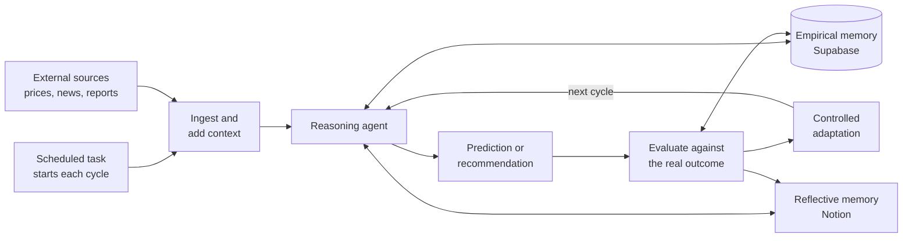
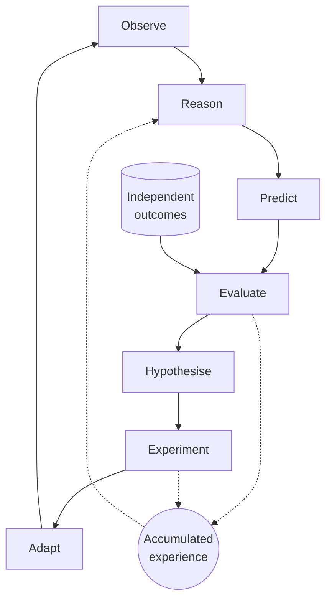

For about seven weeks this autumn I had a scheduled workflow watching markets for me. Brent crude went onto its watchlist on 8 October, and from then on each run produced a careful piece of analysis: what had moved, which supply and geopolitical stories seemed to be driving it, and which way the risks were leaning. In mid-November I split it into two watches with different objectives, one looking for opportunities and one for early signs of a crisis, with shared risk controls and my approval required before anything was acted on.

When I went back through those weeks of output, I could not answer a simple question about it: was it getting any better? Much of the analysis was good. Very little of it, though, had been recorded in a form that could be checked against what happened afterwards. A report might say the risks were tilted upwards, but without a probability, without a horizon, and without a record of which version of the instructions had produced it. Every report had been saved, so in one sense the system remembered everything. It had almost nothing it could learn from.

That observation is where this series starts. The assistants most of us now use have knowledge, tools and access to our applications, and some of them can act. Few have any way of finding out whether their recommendations turned out to be right, and fewer still have a controlled way of changing how they work as a result. I wanted to see what that would take with the model left exactly as it is, using platforms that are already available rather than an application written for the purpose.

## Where this series fits

This is the third series on the blog, and the three grew out of the same practical concern.

| Series | The question it asks |
|---|---|
| [Closing the Loop](neural-symbolic-loop.html) | How should an agent reason? |
| [Designing Agency](designing-agency-0-permission.html) | What should an agent be authorised to do? |
| Intelligence That Compounds | How should an agent learn from experience? |

An agent that adapts its own behaviour can drift away from the reasoning it was validated on, and it can quietly widen the authority it was given, for example by deciding that a strategy it has just invented is now the one it should run. The working principle I have used across all three series is that an agent must be able to reason correctly, act within delegated authority, and learn from consequences without compromising either of the first two. This series is about the third part, and much of it is about protecting the other two.

## Choosing a problem small enough to measure

I wanted a problem where the outcome arrives quickly, is published by someone other than the agent, and can be scored without argument. The commercial decisions I work with in enterprise settings fail all three tests: a sales opportunity can take months to resolve, its status often lives in someone's head, and whether a recommendation helped is a matter of opinion. The free-text views my monitoring workflow produced could not be scored at all.

Brent crude oil passes all three. So the system I built follows one instrument and, for each trading session, states the probability that the price will rise. A probability can be scored the moment the price is known, which means the system never gets to grade its own work. I have no interest here in a profitable oil strategy; Brent is simply a setting in which learning can be measured.

The case study at the centre of the series is a learning algorithm executed over 60 consecutive trading sessions of historical Brent prices, from 25 August to 17 November 2026, one session at a time. Three strategies stated a probability before each outcome was read: two that learned from every outcome, and one fixed at 50% that never learned, so that learning had something to be measured against. That produced 180 forecast comparisons and 60 reflections, one per session. The adaptive strategy's loss fell by 10.3% between the first and last third of the sessions, and yet neither learning strategy beat the fixed baseline over the whole period, so neither was adopted. Part 2 follows that record session by session.

The system is assembled from ChatGPT, a Supabase database and a Notion workspace, configured by conversation. Figure 1 shows the reference design. The experiment implemented the parts of it needed to test the learning loop itself; Part 1 describes which parts those are.

*Figure 1. The reference design. Each cycle ends by checking a prediction against the real outcome, and only tested changes feed into the next cycle.*

*Alt text: A scheduled task starts each cycle. External sources are ingested and given context, then passed to a reasoning agent, which makes a prediction or recommendation. That is evaluated against the real outcome, which leads to controlled adaptation and back to the agent for the next cycle. The agent reads and writes empirical memory in Supabase and reflective memory in Notion; evaluation reads and writes empirical memory and writes to reflective memory.*

## Keeping evidence apart from interpretation

The first design decision came straight from the monitoring weeks. In those reports, observation and interpretation were mixed together in the same paragraphs, so looking back I often could not tell what had been known at the time from what had been inferred. I wanted the new system to keep them in separate places.

Supabase holds the evidence: what was observed, what was predicted, with what confidence and under which strategy, and what actually happened. Those records cannot be edited once written, because a system that can revise its own history will always appear to be improving. Notion holds the interpretation: the learning journal, hypotheses, research notes and proposed changes to the strategy, in a form people can read and comment on.

I did consider simpler arrangements. Keeping everything in Notion would have been easier to set up, but its pages are designed to be edited, including by the agent, which is the wrong property for evidence. Keeping everything in Supabase would have made the record rigorous and left nowhere sensible for the discussion around it. Two stores with different rules turned out to be the simplest design that kept both properties.

There is a research reason for the separation as well. Agents that reflect on their own work can endorse their own mistakes and store them as guidance, which one recent paper calls a *self-confirmation trap*. [Zhu et al.](https://arxiv.org/abs/2606.24428) In this design a hypothesis written in Notion is only a claim. It changes the system's behaviour only after it has been tested against outcomes the agent does not control.

Those outcomes need care of their own. The price that settles a forecast has to come from an independent source, in the way an enterprise system treats its system of record as authoritative over any agent's account of events. Every piece of evidence also needs the time it was published, so that a forecast can be shown to have used only what was known before it was made. Part 1 describes how easily the first version of the design got this wrong.

*Figure 2. The learning loop. Evaluation draws on outcomes from outside the agent, not on the agent's opinion of its own performance.*

*Alt text: A cycle: observe, reason, predict, evaluate, hypothesise, experiment, adapt, and back to observe. Independent outcomes feed into evaluate. Accumulated experience sits at the centre: evaluation and experiments add to it, and reasoning draws on it.*

## What can change when the model does not

Nothing in this design retrains the model. What can change is the material around it: which sources it reads, how it weighs different signals, how closely its stated confidence matches what actually happens, which past cases it recalls, and how it goes about research. There is good evidence that this kind of improvement is possible. Reflexion showed agents improving on benchmark tasks by writing reflections on their failures, and ExpeL by extracting reusable insights from past attempts, in both cases without changing the model's weights. [Shinn et al.](https://arxiv.org/abs/2303.11366)[Zhao et al.](https://arxiv.org/abs/2308.10144) Benchmarks are forgiving environments, though, and I wanted to know what such learning looks like in a noisy one where the measurement is unforgiving.

The analogy I find most useful is an experienced analyst. Their underlying ability probably does not change much over a career. Their methods, sources and judgement do, partly through experience and partly because someone holds them to their track record.

The part I have not fully resolved is governance. If we authorise an agent to carry out a task, have we also authorised it to change how it carries it out? My current answer is that it may propose and test changes to its own strategy, while the decision to adopt one stays with a person, and Part 3 explores where that line should sit in an organisation. Taken together, the experiment has left me with a working thesis: intelligence compounds when experience is preserved, later decisions are informed by it, outcomes are evaluated independently, and adaptations are subject to governance. The rest of the series tests it.

## How the series is organised

[Part 1](intelligence-that-compounds-1-building-it.html) describes the architecture in terms of what each component is responsible for, and how ChatGPT designed most of it by conversation, including the problems I found when I reviewed that design. [Part 2](intelligence-that-compounds-2-what-it-means.html) goes through the 60-session experiment in order, from a system with no experience to one that rejected its own strategies. [Part 3](intelligence-that-compounds-3-organisations.html) considers what the results imply for organisations, where the decisions are commercial, the outcomes are slow, and the question of who approves a change carries more weight.

## Sources

- Shiding Zhu and colleagues, [*Beyond Self-Reflection: An Execute-Distill-Verify Framework for Agentic Experience Learning*](https://arxiv.org/abs/2606.24428), arXiv preprint, June 2026.
- Noah Shinn and colleagues, [*Reflexion: Language Agents with Verbal Reinforcement Learning*](https://arxiv.org/abs/2303.11366), arXiv preprint, 2023.
- Andrew Zhao and colleagues, [*ExpeL: LLM Agents Are Experiential Learners*](https://arxiv.org/abs/2308.10144), AAAI 2024.
