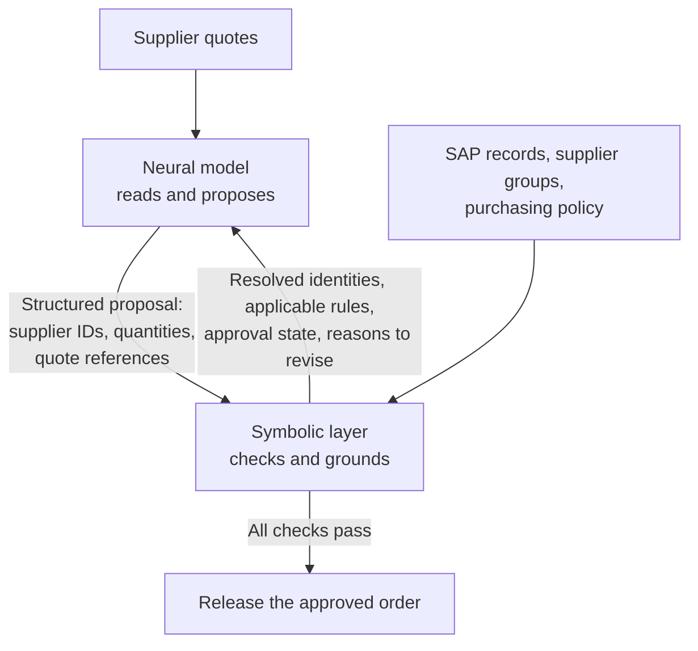
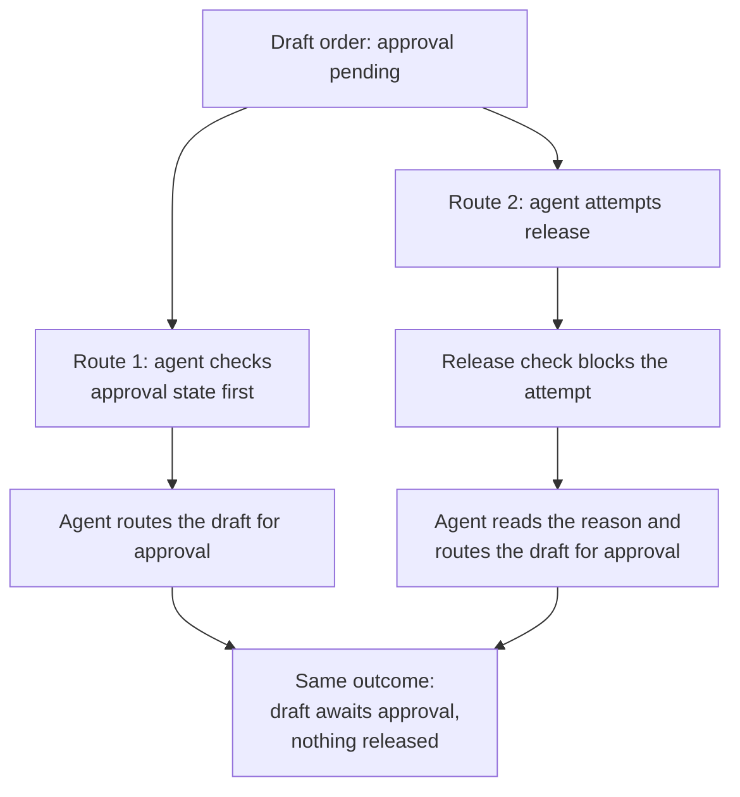

This week I heard the phrase “neural–symbolic loop” in discussions among world leaders about AI. It sent me back to a practical question I keep meeting in enterprise work: when an AI agent finds a good deal that the business is not allowed to take, what is supposed to happen next?

## A good deal that cannot be taken

Take an illustrative case. A procurement agent is asked to find a 15% discount on a recurring order. It reads three supplier quotes and finds one that will offer exactly that, on condition that it receives 80% of the volume. The agent proposes the allocation.

Two facts stand in the way. Purchasing policy caps any single supplier group at 60% of an order. And SAP shows that the draft purchase order is still awaiting approval.

A release check can stop the order, and in a well-built system it will. The more interesting question is what the agent does with that refusal, because the answer tells you how the system was designed.

## Three words, plainly

The **neural** part is the component that learns from examples rather than following written rules. Here it is a language model. It reads quotes laid out in different formats, notices that a discount depends on volume, and turns commercial prose into a proposed allocation. It is good at this, and it can still be wrong: a discount might apply only if everything ships at once, and that condition might sit in a footnote the model skims past.

The **symbolic** part works with facts, relationships and rules that are written down explicitly. A supplier has an identifier. It may belong to a parent group. A purchase order has a version and an approval status. A policy sets a ceiling on how much of an order one group may receive. Once those facts are established, software can do the arithmetic and check the proposal against the rule, the same way every time.

The **loop** is what connects them. The symbolic side’s verdict does not simply end the conversation; it shapes the model’s next move. The model can revise the allocation, ask for missing information or hand the decision to a buyer, and whatever it proposes next passes through the same checks.

## What travels in each direction

For this to work, the model has to send something the symbolic side can check. “Supplier A offers the best price” is advice. A proposal that names supplier IDs, quantities, units and the quote lines each figure came from is something a rule engine can test and an auditor can trace back to its source.

Traffic flows the other way too, and not only after a failure. Before the model proposes anything, the symbolic side can supply the purchasing policy that applies and resolve which supplier records share a parent company. After a proposal fails, it can return a specific reason: the share is 80% against a cap of 60%, and approval for this draft is still pending. Brian Platz of Fluree makes the same argument from the data-engineering side: the hand-off between the two halves should be typed statements about identified entities, not a summary, because you cannot validate a paragraph against a constraint or trace each claim in it back to a source. [Fluree](https://flur.ee/blog/the-neural-symbolic-loop)

With a reason like that, the agent can do something useful. It can test whether a compliant split still earns the discount, and if no allocation meets both the savings target and the cap, it can put the trade-off in front of the buyer rather than guess. At release, the execution layer checks the version actually being released, so approval of an earlier draft cannot quietly authorise a changed one.

*Figure 1. The model proposes; the symbolic layer grounds the proposal in business records, checks it, and either releases the order or tells the model why not.*

*Alt text: Supplier quotes feed a neural model, which sends a structured proposal of supplier IDs, quantities and quote references to a symbolic layer. SAP records, supplier groups and purchasing policy also feed the symbolic layer, which returns resolved identities, applicable rules, approval state and reasons to revise, and releases the order only when all checks pass.*

## Where a planner fits

Checking a proposal is one symbolic job. Producing a plan is another. A classical planner takes a formal description of a problem (the starting state, the goal, the available actions, and what each action requires and changes) and searches for a sequence of steps from one to the other. In procurement, that might mean ordering the steps of routing a draft, obtaining approval and releasing it.

The LOOP preprint describes this kind of arrangement. A language model writes the formal description, a classical planner solves it, and the model refines the description using the planner’s feedback instead of translating once and hoping. Its analysis of a one-shot baseline is a useful warning: many failures traced back to generated descriptions with missing action preconditions and incomplete effects. A planner can only be as right as the problem it is given. Leave out a precondition, and it will return a plan that looks valid and fails on contact with reality. [LOOP preprint](https://arxiv.org/html/2508.13371v1)

Duggan and colleagues compared vision-language-action models with a hybrid that pairs symbolic planning with learned low-level control, on Towers of Hanoi manipulation tasks in simulation. The hybrid reached 78% success on an unseen four-block variant, where both vision-language-action models failed to complete the task. [Duggan et al.](https://arxiv.org/abs/2602.19260) Gary Marcus reads the result as support for hybrids, while cautioning that the system is purpose-built and that a neural–symbolic approach is a starting point, not a panacea. [Marcus](https://garymarcus.substack.com/p/even-more-good-news-for-the-future) That is the right weight to give it: one structured task, in simulation, pointing in a clear direction.

## Reading a quiet outcome

Suppose the test ends with the order unreleased. That looks like success, but it can hide three stories. The model may have seen the pending approval and routed the draft correctly. It may have tried to release the order and been stopped by the control. Or it may have been stopped, read the reason and recovered.

To tell them apart, inspect three things: the first action the agent proposed, the response from the policy check, and the agent’s next proposal. Keep the request, permissions and draft fixed while changing only the approval state, and test the release check on its own with a deliberately prohibited action. A failure can then be pinned on the model, the control or the feedback between them.

*Figure 2. Two routes to the same unreleased order: one agent used the approval state up front, the other learned it from a blocked attempt.*

*Alt text: A draft order with approval pending leads to two routes. In the first, the agent checks the approval state and routes the draft for approval. In the second, the agent attempts release, the release check blocks it, and the agent then routes the draft for approval. Both routes end with the draft awaiting approval and nothing released.*

## What counts as one supplier?

Now the agent tries again. It proposes a 50–50 split between two supplier IDs in SAP, comfortably under the 60% cap. Except that both suppliers belong to the same parent company. If the policy counts concentration at group level, the split still puts 100% of the order with one group.

The arithmetic was never the hard part. The hard part is knowing which entities the rule is meant to count, and that is a question about meaning, not maths. Defining what a supplier, a legal entity and a corporate group are, and how they relate, is the work of an ontology. How those definitions become shared across the business, its systems and the agents acting for it is where I want to go next.

## Sources

- Brian Platz, [*The Neural-Symbolic Loop: Where Data Engineering Meets Reasoning*](https://flur.ee/blog/the-neural-symbolic-loop), Fluree, August 2026.
- Ronit Virwani and Ruchika Suryawanshi, [*LOOP: A Plug-and-Play Neuro-Symbolic Framework for Enhancing Planning in Autonomous Systems*](https://arxiv.org/html/2508.13371v1), arXiv preprint, 2025.
- Timothy Duggan, Pierrick Lorang, Hong Lu and Matthias Scheutz, [*The Price Is Not Right: Neuro-Symbolic Methods Outperform VLAs on Structured Long-Horizon Manipulation Tasks with Significantly Lower Energy Consumption*](https://arxiv.org/abs/2602.19260), arXiv, accepted at ICRA 2026.
- Gary Marcus, [*Even more good news for the future of neurosymbolic AI*](https://garymarcus.substack.com/p/even-more-good-news-for-the-future), Marcus on AI, April 2026.
